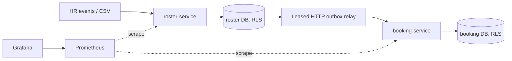

# HR Roster Sync

Two Java 21 / Spring Boot services reconcile HR events and full employee exports into a versioned roster, then cancel future bookings and release seats through a transactional outbox. PostgreSQL row-level security supplements JWT tenant and role checks.

**Demo video:** VIDEO_LINK_TODO

**Start here** (Docker with Compose, `curl`, `jq`; about ten minutes):

```bash
docker compose up -d --build --wait          # first build compiles inside Docker: allow 3–5 minutes
scripts/demo/quick.sh                        # two-minute tour of the guarantees against the running stack
scripts/faults/kill-roster-after-commit.sh   # the brief's crash test: dies after commit, recovers, cancels once
```

`make up`, `make tour`, `make crash`, `make test` and `make down` run the same steps.

## Results

Measured on Nobara Linux 44, 32 logical CPUs and 31 GiB RAM, Temurin 21.0.13 and PostgreSQL 18.6. The reconciliation JVM is capped at 256 MiB. Each reconciliation figure comes from three measured runs that each start from a freshly restored baseline, with no separate warm-up run, so the times include JVM warm-up.

| Check | Result |
|---|---|
| Typical 200k digest + assessment + apply | 1.073 s median (1.063–1.076 s) |
| Typical full run, including staging | 2.966 s median |
| Heavy night, 100k updates: digest + assessment + apply | 5.314 s median |
| Maximum sampled heap across six scenarios | 252.0 MiB; JVM limit 256 MiB |
| API at 1,000/s, 60 seconds | 60,001 completed; p50 2.05 ms / p99 4.33 ms / p99.9 14.29 ms; 0 failures, 0 drops |
| API p99 overlapping reconciliation lock at 250/s | 1109.64 ms |
| Default Maven tests | 315: 89 unit and 226 integration; zero failures/errors/skips |
| Randomized and concurrency coverage | Two 1,000-seed tests; nine concurrency test cases (included above) |
| Process fault injection | Six scenarios × three passing runs; both commit-crash demos repeated on Linux |
| Observability | Two UP targets, six tested alerts, 12 rendered dashboard panels |

At 1,000/s, delivered-event p99 lag was about 15.7 seconds and the sampled queue still had 12,874 pending events. HTTP acceptance does not complete downstream work. [Full results](docs/benchmark.md), [machine and raw measurements](bench/results/), [fault summary](docs/fault-runs/SUMMARY.txt), and [validation evidence](docs/validation/README.md) retain the measurements and limitations.

## Judgement calls

Detailed context, rejected alternatives and consequences are in [DEC-01–23](docs/decisions.md).

| Decision | Choice |
|---|---|
| DEC-01: Full HR state | Events carry all HR-owned fields. |
| DEC-02: Source ordering | A tenant-wide monotonic sourceSeq orders HR changes and export cutoffs. |
| DEC-03: Versioned deactivation | Persist deactivation versions, including tombstones for unknown IDs. |
| DEC-04: Snapshot cutoff | Only active rows at or below cutoff S can be inferred absent. |
| DEC-05: Exact safety brake | Compare integer basis points; default 3000, and baseline must be positive. |
| DEC-06: Transport ownership on rehire | Keep transport columns across HR updates and reactivation. |
| DEC-07: Office transfer review | Preserve pickup and emit PICKUP_REVIEW_NEEDED. |
| DEC-08: Invalid evidence | Invalid, unidentifiable or conflicting rows suppress all inferred absences. |
| DEC-09: Manifest mismatch | Row-count mismatch prevents approval; checksum/structure failure is INCOMPLETE. |
| DEC-10: Atomic snapshot apply | Assess and apply in one bulk transaction under an exclusive tenant/source lock. |
| DEC-11: HTTP outbox delivery | Push over HTTP with at-least-once retries and atomic consumer dedup. |
| DEC-12: Per-employee delivery order | Earlier undelivered revisions block later ones, including DEAD predecessors. |
| DEC-13: Future bookings | Cancel RESERVED bookings whose scheduled start is after the event effectiveAt. |
| DEC-14: Reactivation and bookings | Reactivation updates the projection without restoring bookings. |
| DEC-15: Equal-version conflict | Equal sequence with different intent or canonical HR hash is a conflict. |
| DEC-16: Development issuer | Use the configurable demo issuer and persistent RS256 key; validate issuer, audience and expiry in both services. |
| DEC-17: Admin deactivation version | Admin deactivation increments aggregateRevision and leaves sourceSeq unchanged. |
| DEC-18: Seen IDs in staging | Keep a seen-ID set and stage in 5,000-row COPY chunks. |
| DEC-19: Reconciliation changed fields | Compute detailed field names from PostgreSQL 18 RETURNING old/new values. |
| DEC-20: Unknown employee tombstones | Persist the version floor without fabricating an HR profile or outbox event. |
| DEC-21: Bucket and version digest | Use 65,536 SHA-256 buckets; include employee ID, canonical hash and sequence in each digest. |
| DEC-22: Bulk connection pool | Use separate pools with 10s/330s socket timeouts and 5s/300s statement timeouts. |
| DEC-23: Same-cutoff lineage | Compare against COMPLETED runs: equal checksum is a no-op, different checksum conflicts; allow resend after partial/failed runs if no completed truth exists. |

## Quick start

Docker Engine with Compose is enough to build and run both services. Ports 8080/8081 must be free. The first build compiles both services inside Docker and downloads their dependencies, which takes a few minutes; later builds reuse the cache.

```bash
git clone https://github.com/Theroid00/HR.git
cd HR
docker compose up -d --build --wait
```

Startup seeds `acme` and `globex`, three offices, 100 employees per tenant, trips, 300 future bookings and 20 past bookings in total. Demo users are `hr@acme`, `admin@acme`, `ops@acme`, `emp001@acme`, and their `globex` equivalents; password `demo123`. The employee account is bound to `EMP-001`. Five sample curls (jq extracts the tokens):

```bash
HR=$(curl -fsS http://localhost:8080/api/v1/auth/token -H 'Content-Type: application/json' -d '{"username":"hr@acme","password":"demo123"}' | jq -r .accessToken)
ADMIN=$(curl -fsS http://localhost:8080/api/v1/auth/token -H 'Content-Type: application/json' -d '{"username":"admin@acme","password":"demo123"}' | jq -r .accessToken)
curl -fsS http://localhost:8080/api/v1/hr/events -H "Authorization: Bearer $HR" -H 'Content-Type: application/json' -d '{"eventId":"readme-create","sourceSeq":1001,"eventType":"UPSERT","employeeId":"README-001","effectiveAt":"2026-10-31T00:00:00Z","hr":{"name":"Synthetic Employee","email":"synthetic@example.test","phone":"+919000000999","managerId":null,"officeCode":"BLR-A","shiftCode":"MORNING"}}'
curl -fsS http://localhost:8080/api/v1/employees/README-001 -H "Authorization: Bearer $ADMIN"
curl -fsS -X PATCH http://localhost:8080/api/v1/employees/README-001/transport -H "Authorization: Bearer $ADMIN" -H 'If-Match: "1"' -H 'Content-Type: application/json' -d '{"pickupPoint":"Demo stop","specialAssistance":null}'
```

Import the [Postman collection and environment](postman/README.md) for all 29 endpoint requests. Read the employee again before another transport edit to obtain its current ETag. A repeat of the create is a no-op; the PATCH example assumes the first revision.

```bash
docker compose --profile observability up -d
scripts/check-observability.sh
```

Grafana: <http://localhost:3000/d/roster-sync/roster-sync> (`admin` / `demo123`). Prometheus: <http://localhost:9090>. [Dashboard capture](docs/validation/dashboard.png).

## Coverage audit

This preserves every requirement ID from the original coverage audit and links to implemented proofs. Historical plan-only test names are mapped to the executable test catalog.

| ID | Requirement | Implemented proof |
|---|---|---|
| C1 | Changes arrive via API in near real time | [roster IngestApiIT](roster-service/src/test/java/com/moveinsync/rostersync/roster/IngestApiIT.java) |
| C2 | Full nightly export of up to 200,000 employees as a file | [roster ReconciliationBenchmarkIT](roster-service/src/test/java/com/moveinsync/rostersync/roster/ReconciliationBenchmarkIT.java) |
| C3 | Updates arrive twice | [roster IngestApiIT](roster-service/src/test/java/com/moveinsync/rostersync/roster/IngestApiIT.java), [roster ReplayIT](roster-service/src/test/java/com/moveinsync/rostersync/roster/ReplayIT.java) |
| C4 | …arrive out of order | [roster IngestApiIT](roster-service/src/test/java/com/moveinsync/rostersync/roster/IngestApiIT.java), [roster RacingVersionsIT](roster-service/src/test/java/com/moveinsync/rostersync/roster/RacingVersionsIT.java) |
| C5 | …contain bad data | [roster RecordValidatorTest](roster-service/src/test/java/com/moveinsync/rostersync/roster/core/RecordValidatorTest.java), [roster ValidationIT](roster-service/src/test/java/com/moveinsync/rostersync/roster/ValidationIT.java) |
| C6 | …are sometimes cut short | [roster ReconciliationIT](roster-service/src/test/java/com/moveinsync/rostersync/roster/ReconciliationIT.java), [roster BriefExampleIT](roster-service/src/test/java/com/moveinsync/rostersync/roster/BriefExampleIT.java) |
| C7 | Some fields belong to HR, some to transport admin | [roster OwnershipIT](roster-service/src/test/java/com/moveinsync/rostersync/roster/OwnershipIT.java) |
| C8 | Create, update, deactivate events with source version/timestamp | [roster IngestApiIT](roster-service/src/test/java/com/moveinsync/rostersync/roster/IngestApiIT.java) |
| C9 | Reject invalid records (malformed phone, unknown office) with per-record error report | [roster ValidationIT](roster-service/src/test/java/com/moveinsync/rostersync/roster/ValidationIT.java) |
| C10 | One bad record never fails a whole batch | [roster ValidationIT](roster-service/src/test/java/com/moveinsync/rostersync/roster/ValidationIT.java), [roster ReconciliationIT](roster-service/src/test/java/com/moveinsync/rostersync/roster/ReconciliationIT.java) |
| C11 | Apply changes per employee in version order | [roster RacingVersionsIT](roster-service/src/test/java/com/moveinsync/rostersync/roster/RacingVersionsIT.java) |
| C12 | Stale update ignored | [roster IngestApiIT](roster-service/src/test/java/com/moveinsync/rostersync/roster/IngestApiIT.java) |
| C13 | Duplicate is a no-op | [roster IngestApiIT](roster-service/src/test/java/com/moveinsync/rostersync/roster/IngestApiIT.java), [roster OutboxIT](roster-service/src/test/java/com/moveinsync/rostersync/roster/OutboxIT.java) |
| C14 | HR owns name, email, manager, office | [roster OwnershipIT](roster-service/src/test/java/com/moveinsync/rostersync/roster/OwnershipIT.java) |
| C15 | Transport admin owns pickup point, special-assistance | [roster OwnershipIT](roster-service/src/test/java/com/moveinsync/rostersync/roster/OwnershipIT.java) |
| C16 | HR update never overwrites a transport-owned field | [roster OwnershipIT](roster-service/src/test/java/com/moveinsync/rostersync/roster/OwnershipIT.java) |
| C17 | The conflict rule is written down | [Decisions](docs/decisions.md) |
| C18 | Compare 200k export with the store without loading both fully in memory (hash per record + hashed buckets) | [roster ReconciliationBenchmarkIT](roster-service/src/test/java/com/moveinsync/rostersync/roster/ReconciliationBenchmarkIT.java) |
| C19 | Safety brake: export missing 30% of active employees → stop | [roster SafetyBrakeTest](roster-service/src/test/java/com/moveinsync/rostersync/roster/core/SafetyBrakeTest.java), [roster ReconciliationIT](roster-service/src/test/java/com/moveinsync/rostersync/roster/ReconciliationIT.java) |
| C20 | …alert an operator | [roster ReconciliationIT](roster-service/src/test/java/com/moveinsync/rostersync/roster/ReconciliationIT.java), [live alert evidence](docs/validation/p12-alerts.json) |
| C21 | …deactivate nobody until a human approves | [roster ReconciliationIT](roster-service/src/test/java/com/moveinsync/rostersync/roster/ReconciliationIT.java) |
| C22 | Publish a change event for every applied change using the outbox pattern | [roster OutboxIT](roster-service/src/test/java/com/moveinsync/rostersync/roster/OutboxIT.java) |
| C23 | DB update and event can never disagree | [Commit-crash test](scripts/faults/kill-roster-after-commit.sh), [roster OutboxIT](roster-service/src/test/java/com/moveinsync/rostersync/roster/OutboxIT.java) |
| C24 | Deactivated employee: future bookings cancelled | [booking ConsumerIT](booking-service/src/test/java/com/moveinsync/rostersync/booking/ConsumerIT.java) |
| C25 | …and seat freed | [booking ConsumerIT](booking-service/src/test/java/com/moveinsync/rostersync/booking/ConsumerIT.java), [booking SeatAllocatorTest](booking-service/src/test/java/com/moveinsync/rostersync/booking/core/SeatAllocatorTest.java) |
| C26 | Example: v7 transfer before v6 shift → shift ignored; new office with v7 shift | [roster BriefExampleIT](roster-service/src/test/java/com/moveinsync/rostersync/roster/BriefExampleIT.java) |
| C27 | Example: file cut at 120,000 rows → brake, nobody deactivated, operator sees how many records missing | [roster BriefExampleIT](roster-service/src/test/java/com/moveinsync/rostersync/roster/BriefExampleIT.java), [roster ReconciliationBenchmarkIT](roster-service/src/test/java/com/moveinsync/rostersync/roster/ReconciliationBenchmarkIT.java) |
| C28 | Define the idempotency key and the version comparison | [Design note](docs/design-note.md), [decisions](docs/decisions.md) |
| C29 | Test that replays the same feed twice and changes nothing | [roster ReplayIT](roster-service/src/test/java/com/moveinsync/rostersync/roster/ReplayIT.java), [roster ReplayIdempotenceTest](roster-service/src/test/java/com/moveinsync/rostersync/roster/core/ReplayIdempotenceTest.java) |
| C30 | Brake threshold configurable | [roster SafetyBrakeTest](roster-service/src/test/java/com/moveinsync/rostersync/roster/core/SafetyBrakeTest.java), [roster CacheIT](roster-service/src/test/java/com/moveinsync/rostersync/roster/CacheIT.java) |
| C31 | Never write personal data into logs or error reports; use employee IDs | [roster NoPiiIT](roster-service/src/test/java/com/moveinsync/rostersync/roster/NoPiiIT.java) |
| C32 | Diff a 200,000-row snapshot in under 60 s with bounded memory | [Measured benchmark](docs/benchmark.md) |
| C33 | Test that crashes the process between the DB write and the event publish | [Process crash script](scripts/faults/kill-roster-after-commit.sh), [18 runs](docs/fault-runs/SUMMARY.txt) |
| P1 | Authentication, roles (employee/admin/operator), tenant isolation | [booking SecurityMatrixIT](booking-service/src/test/java/com/moveinsync/rostersync/booking/SecurityMatrixIT.java), [roster SecurityMatrixIT](roster-service/src/test/java/com/moveinsync/rostersync/roster/SecurityMatrixIT.java), [booking RlsIT](booking-service/src/test/java/com/moveinsync/rostersync/booking/RlsIT.java), [roster RlsIT](roster-service/src/test/java/com/moveinsync/rostersync/roster/RlsIT.java) |
| P2 | Time/space complexity + benchmark + where it stops scaling | [Complexity and limits](#trade-offs-and-scaling-limits), [benchmark](docs/benchmark.md) |
| P3 | Crashes, timeouts, duplicate/out-of-order messages, partial failures; failure-injection test | [Fault evidence](docs/fault-runs/SUMMARY.txt), [roster DbFailuresTest](roster-service/src/test/java/com/moveinsync/rostersync/roster/api/DbFailuresTest.java) |
| P4 | OOP: encapsulation, inheritance, polymorphism, controller/service/repository | [roster CoreIsPureTest](roster-service/src/test/java/com/moveinsync/rostersync/roster/core/CoreIsPureTest.java), [layers](#architecture) |
| P5 | Trade-offs: consistency vs availability vs latency; what's left out | [Design note](docs/design-note.md), [trade-offs](#trade-offs-and-scaling-limits) |
| P6 | Metrics + structured logging; lag, error rate, rejections, retries, queue depth | [Monitoring configuration](ops/README.md), [rendered dashboard](docs/validation/dashboard.png) |
| P7 | Caching with eviction; what's stale, how long, how bounded | [roster CacheIT](roster-service/src/test/java/com/moveinsync/rostersync/roster/CacheIT.java) |
| P8 | Error framework, non-leaking messages, no PII in logs or responses | [roster ErrorContractIT](roster-service/src/test/java/com/moveinsync/rostersync/roster/ErrorContractIT.java), [roster NoPiiIT](roster-service/src/test/java/com/moveinsync/rostersync/roster/NoPiiIT.java) |
| A1 | Every hard rule has an automated test, incl. ≥1 concurrency and ≥1 failure test | [roster RacingVersionsIT](roster-service/src/test/java/com/moveinsync/rostersync/roster/RacingVersionsIT.java), [faults](docs/fault-runs/SUMMARY.txt), [test manifest](scripts/required-tests.txt) |
| A2 | Load test/benchmark with throughput and p50/p99, machine stated | [Machine and measurements](docs/benchmark.md) |
| A3 | 1–2 page design note: architecture diagram, sequence diagram (hardest flow), failure-mode table | [Design note](docs/design-note.md) |
| A4 | One-command run incl. DB | [Compose](docker-compose.yml) |
| I1 | Understand requirements, hard rules, scale | [Design specification](docs/spec/), this audit |
| I2 | Language choice defended | [Language choice](#language-choice) |
| I3 | Design first: data model, components, APIs, failure modes in the design note | [Design note](docs/design-note.md) |
| I4 | Clean layered code, core algorithm in plain classes testable without web/DB | [roster CoreIsPureTest](roster-service/src/test/java/com/moveinsync/rostersync/roster/core/CoreIsPureTest.java) |
| I5 | Normal + edge-case tests; unit, concurrency, failure, benchmark | [Required test manifest](scripts/required-tests.txt), [faults](docs/fault-runs/SUMMARY.txt), [benchmarks](docs/benchmark.md) |
| I6 | README: how to run, assumptions, benchmark results, trade-offs | This README and [measurements](docs/benchmark.md) |
| I7 | Public GitHub repo, meaningful commit history | [Commit history](https://github.com/Theroid00/HR/commits/main): small, reviewed steps from scaffold to release |
| I8 | Demo video: main flows, one live failure, sample API calls (Postman/curl) | [Automated demo](scripts/demo/run-all.sh), [Postman](postman/README.md); the video is linked at the top of this README |

## Architecture



Both databases run in one PostgreSQL container. A transaction writes each employee change, history and outbox event together. The consumer commits durable dedup, projection changes, future booking cancellation and seat release together. Seats are capacity minus active reservations. Controllers handle HTTP/authorization, services own transactions, repositories hold SQL, and core policies run without Spring or JDBC. See the [design note](docs/design-note.md) for the crash sequence.

### Where to look in the code

| Concern | Start with |
|---|---|
| Version gate: stale, duplicate, conflict, tombstone | [VersionPolicy](roster-service/src/main/java/com/moveinsync/rostersync/roster/core/VersionPolicy.java), then [HrEventService](roster-service/src/main/java/com/moveinsync/rostersync/roster/service/HrEventService.java) |
| Nightly diff, safety brake and approval | [SnapshotApplier](roster-service/src/main/java/com/moveinsync/rostersync/roster/service/SnapshotApplier.java), then the SQL in [ReconciliationApplyRepository](roster-service/src/main/java/com/moveinsync/rostersync/roster/repository/ReconciliationApplyRepository.java) |
| Streaming the export into staging | [SnapshotStager](roster-service/src/main/java/com/moveinsync/rostersync/roster/service/SnapshotStager.java), [StagingRepository](roster-service/src/main/java/com/moveinsync/rostersync/roster/repository/StagingRepository.java) |
| Outbox relay: leases, per-employee order, retries | [OutboxRelay](roster-service/src/main/java/com/moveinsync/rostersync/roster/outbox/OutboxRelay.java), [OutboxRelayRepository](roster-service/src/main/java/com/moveinsync/rostersync/roster/repository/OutboxRelayRepository.java) |
| Idempotent consumer: cancellations and seats | [EmployeeEventConsumer](booking-service/src/main/java/com/moveinsync/rostersync/booking/consumer/EmployeeEventConsumer.java), [BookingService](booking-service/src/main/java/com/moveinsync/rostersync/booking/service/BookingService.java) |
| Tenant isolation and roles | [Row-level security](roster-service/src/main/resources/db/migration/V2__rls.sql), [SecurityConfig](roster-service/src/main/java/com/moveinsync/rostersync/roster/security/SecurityConfig.java) |

## Trade-offs and scaling limits

- Atomic reconciliation holds a tenant/source lock, increasing concurrent API latency; the measured overlap p99 is about 1.1 seconds. Lock waits beyond three seconds return retryable 503.
- Bookings are eventually consistent with roster commits. At 1,000/s, the measured relay accumulates backlog even while ingest remains fast; consult queue age as well as delivered-event latency.
- Safety takes precedence over inferred absence: a brake blocks all live changes, and invalid/conflicting evidence suppresses inferred deactivations. Incomplete manifests require corrected uploads.
- Digest work scans both sides. Staging uses O(M) database space, 5,000-row chunks and a seen-ID set; Java digest maps use O(B) entries for B=65,536. Quiet changes touched 99 buckets; heavy nights touch most useful buckets.
- API writes use indexed employee lookup/locking, roughly O(log N); snapshot classification and apply operate on mismatched buckets. A single database primary, tenant lock duration and the HTTP relay bound scale. Chunked/resumable apply, tenant partitioning and CDC/broker delivery would require a new design and measurements.
- Delivered outbox retention is seven days. Consumer dedup is currently retained indefinitely; a 30-day purge is not implemented. Snapshot uploads and operator history also require an operational retention policy.
- The development issuer, demo credentials, public actuator metrics and unencrypted demo database credentials are for this local assessment setup. Production needs managed identity/secrets, network access controls, backup/retention and PII encryption/erasure policies.

No broker, patch-event protocol, multi-source resolution, multi-region system or frontend application is included. Prometheus rules are available locally; external notification routing requires Alertmanager configuration.

### Cache behavior

| Cache | Bound / TTL | Staleness and invalidation |
|---|---|---|
| officeCatalog | 10,000 tenants / 5 minutes | Local office writes evict; remote changes may take the TTL. A foreign key protects references, while active-office status depends on validation/cache freshness. |
| tenantConfig | 10,000 tenants / 60 seconds | Local config writes evict; remote threshold changes may take the TTL. |
| tenantSource | 10,000 source keys / 10 minutes | Caches immutable lock keys only. The absence watermark and employee versions are read in the transaction. |

## Run tests, faults, benchmarks and demo

Full validation needs JDK 21 **including javac**, Docker/Compose, bash, curl, jq and Python 3. Select the JDK using `JAVA_HOME` and put its `bin` on `PATH`; see [host notes](docs/known-issues.md). Node is used only for the offline Postman self-check, without npm packages.

```bash
java -version && javac -version
./mvnw verify && scripts/check-tests.sh
node postman/check.mjs
scripts/faults/run-all.sh
scripts/bench/run-all.sh
scripts/demo/run-all.sh
```

The fault, benchmark and demo runners delete and recreate this Compose project’s volumes. Use an isolated checkout. The demo runs tests and real process crashes, verifies 80,000 missing out of 200,000 with zero mutations, then restores the seeded stack and observability. Benchmarks use real PostgreSQL, exact outcome assertions, the 256 MiB heap cap and three measured runs without warm-up; no benchmark results are estimated. [Protocol and commands](bench/README.md).

## Language choice

Java 21 and Spring Boot provide explicit records, mature JDBC transactions, JWT validation, validation hooks, connection pools and instrumentation. The core version, hashing, validation and brake policies remain ordinary Java, so their invariants can be tested without a web server or database. SQL stays visible for the version guards, tenant policies, locks and atomic outbox writes that determine correctness.
