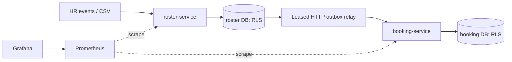

# HR Roster Sync

> ## ▶ [Watch the demo video (4 min 47 s)](docs/demo/demo.mp4)
>
> The system running end to end: the one-command start, the main flows, sample API calls and a live crash between the database write and the event publish. [Open the video](docs/demo/demo.mp4) · [download it (MP4, 77 MB)](https://github.com/Theroid00/HR/raw/main/docs/demo/demo.mp4)

## Run it

One command starts everything: PostgreSQL, both services and the demo data (first build 3–5 minutes, later starts seconds).

```bash
docker compose up -d --build --wait
```

Then see it work:

```bash
scripts/demo/quick.sh                        # two-minute demo: ordering, duplicates, field ownership, bad data, tenants, bookings, safety brake
scripts/faults/kill-roster-after-commit.sh   # the brief's crash test: dies between commit and publish, recovers, cancels exactly once
```

All three in one line: `make up tour crash`. Stop and delete everything: `make down`.

The one command needs only Docker with Compose v2. Java, Maven and PostgreSQL all run inside containers, every image is published for both Intel and ARM (Apple Silicon), and line endings are pinned so a Windows checkout builds the same images. The demo scripts and the checks below are bash scripts and also need `curl` and `jq`:

| OS | Install the prerequisites |
|---|---|
| macOS | `scripts/setup.sh --install` (Homebrew; adds Colima if there is no Docker) |
| Linux | `scripts/setup.sh --install` (apt or dnf; prints the official Docker Engine steps if Docker is missing) |
| Windows | In PowerShell: `winget install -e --id Docker.DockerDesktop`. The one command then works from PowerShell. For the bash scripts, run `wsl --install`, enable WSL integration in Docker Desktop, open the **Ubuntu** terminal, clone the repository there and use the commands above (`scripts/setup.sh --install` adds `curl` and `jq`). |

`scripts/setup.sh` without `--install` only checks and prints what is missing. Verified on macOS (Apple Silicon, Colima) and Linux (x86_64); the Windows steps are documented but have not been run on a Windows machine.

## Test it yourself

Paste these into a terminal while the stack runs. Each check is a requirement from the case study, followed by what you should see. Start from a fresh stack (`make down && make up`) so the numbers match exactly.

**Setup:** two helpers and three demo logins (password `demo123`).

```bash
token() { curl -s localhost:8080/api/v1/auth/token -H 'Content-Type: application/json' -d "{\"username\":\"$1\",\"password\":\"demo123\"}" | jq -r .accessToken; }
HR=$(token hr@acme); ADMIN=$(token admin@acme); OPS=$(token ops@acme)
event() { curl -s localhost:8080/api/v1/hr/events -H "Authorization: Bearer $HR" -H 'Content-Type: application/json' -d "$1" | jq -c '{outcome} + (if .errorCode then {errorCode, errors} else {} end)'; }
```

**1. Out of order: the v7 office transfer arrives before the v6 shift change.**

```bash
event '{"eventId":"t-v7","sourceSeq":1007,"eventType":"UPSERT","employeeId":"T-1","effectiveAt":"2026-10-31T09:00:00Z","hr":{"name":"Test One","email":"t1@example.test","phone":"+919000099001","managerId":null,"officeCode":"GGN-A","shiftCode":"NIGHT"}}'
event '{"eventId":"t-v6","sourceSeq":1006,"eventType":"UPSERT","employeeId":"T-1","effectiveAt":"2026-10-31T08:00:00Z","hr":{"name":"Test One","email":"t1@example.test","phone":"+919000099001","managerId":null,"officeCode":"BLR-A","shiftCode":"MORNING"}}'
curl -s localhost:8080/api/v1/employees/T-1 -H "Authorization: Bearer $ADMIN" | jq -c '{officeCode, shiftCode, sourceSeq}'
```

Expect `APPLIED`, then `STALE`, then `{"officeCode":"GGN-A","shiftCode":"NIGHT","sourceSeq":1007}`.

**2. A duplicate is a no-op.** Run the first `event` line from check 1 again. Expect `{"outcome":"DUPLICATE"}`.

**3. Bad records are rejected one by one; the rest of the batch still applies.**

```bash
curl -s localhost:8080/api/v1/hr/events/batch -H "Authorization: Bearer $HR" -H 'Content-Type: application/x-ndjson' --data-binary @samples/batch-one-bad.ndjson | jq -c '.summary, (.results[] | {line, outcome, errors})'
```

Expect 2 `APPLIED` and 2 `REJECTED`: line 2 `PHONE_E164`, line 3 `OFFICE_UNKNOWN`. The rejected values never appear in the response.

**4. Field ownership: an HR update never overwrites the transport admin's pickup point.**

```bash
curl -s -X PATCH localhost:8080/api/v1/employees/T-1/transport -H "Authorization: Bearer $ADMIN" -H 'If-Match: "1"' -H 'Content-Type: application/json' -d '{"pickupPoint":"Gate 4","specialAssistance":null}' | jq -c .
event '{"eventId":"t-v8","sourceSeq":1008,"eventType":"UPSERT","employeeId":"T-1","effectiveAt":"2026-10-31T10:00:00Z","hr":{"name":"Test One","email":"t1@example.test","phone":"+919000099001","managerId":null,"officeCode":"BLR-B","shiftCode":"NIGHT"}}'
curl -s localhost:8080/api/v1/employees/T-1 -H "Authorization: Bearer $ADMIN" | jq -c '{officeCode, pickupPoint}'
event '{"eventId":"t-v9","sourceSeq":1009,"eventType":"UPSERT","employeeId":"T-1","effectiveAt":"2026-10-31T11:00:00Z","hr":{"name":"Test One","email":"t1@example.test","phone":"+919000099001","managerId":null,"officeCode":"BLR-B","shiftCode":"NIGHT","pickupPoint":"Gate 9"}}'
```

Expect revision 2 from the PATCH, `APPLIED` for the HR update, `{"officeCode":"BLR-B","pickupPoint":"Gate 4"}`, and `UNKNOWN_FIELD` when an HR payload tries to set the pickup point.

**5. A leaver's future bookings are cancelled and their seats freed.**

```bash
curl -s localhost:8081/api/v1/employees/EMP-020/bookings -H "Authorization: Bearer $ADMIN" | jq -c '[.[] | {status, seatState}]'
event '{"eventId":"t-leave","sourceSeq":1010,"eventType":"DEACTIVATE","employeeId":"EMP-020","effectiveAt":"2026-10-31T09:00:00Z"}'
sleep 2; curl -s localhost:8081/api/v1/employees/EMP-020/bookings -H "Authorization: Bearer $ADMIN" | jq -c '[.[] | {status, seatState}]'
```

Expect three `RESERVED`/`ACTIVE` bookings before, and the same three as `CANCELLED`/`RELEASED` after.

**6. Nightly export: only the differences are applied.** [`samples/nightly.csv`](samples/nightly.csv) moves EMP-005 to another office, drops EMP-100 and adds EMP-101.

```bash
RUN=$(curl -s localhost:8080/api/v1/reconciliations -H "Authorization: Bearer $OPS" -F file=@samples/nightly.csv -F 'manifest={"sourceId":"hr-main","cutoffSeq":200,"exportedAt":"2026-10-31T02:00:00Z"};type=application/json' | jq -r .runId)
sleep 3; curl -s localhost:8080/api/v1/reconciliations/$RUN -H "Authorization: Bearer $OPS" | jq -c '{status, counts: (.counts | {created, updated, deactivated}), bucketsMismatched}'
```

Expect `COMPLETED` with `created 1`, `updated 1`, `deactivated 1`, and only a handful of mismatched buckets out of 65,536.

**7. Safety brake: a file cut short stops, deactivates nobody and shows how many look missing.** [`samples/nightly-cut.csv`](samples/nightly-cut.csv) has only the first 60 employees.

```bash
RUN=$(curl -s localhost:8080/api/v1/reconciliations -H "Authorization: Bearer $OPS" -F file=@samples/nightly-cut.csv -F 'manifest={"sourceId":"hr-main","cutoffSeq":300,"exportedAt":"2026-10-31T02:00:00Z"};type=application/json' | jq -r .runId)
sleep 3; curl -s localhost:8080/api/v1/reconciliations/$RUN -H "Authorization: Bearer $OPS" | jq -c '{status, baseline, missing, ratioBp}'
curl -s localhost:8080/api/v1/employees/EMP-090 -H "Authorization: Bearer $ADMIN" | jq -c '{active}'
curl -s -X POST localhost:8080/api/v1/reconciliations/$RUN/reject -H "Authorization: Bearer $OPS" | jq -c '{status}'
```

Expect `AWAITING_APPROVAL` with about 40 of 99 active employees missing (`ratioBp` about 4000, i.e. 40%), EMP-090 still `{"active":true}`, then `REJECTED` once the operator rejects it.

**8. Tenant isolation: another client cannot see this employee.**

```bash
curl -s -o /dev/null -w '%{http_code}\n' localhost:8080/api/v1/employees/T-1 -H "Authorization: Bearer $(token admin@globex)"
```

Expect `404`.

**9. Crash between the database write and the event publish, plus the automated suites.**

```bash
scripts/faults/kill-roster-after-commit.sh   # ~15 s: kills roster right after commit, restarts it, checks exactly-once effects
make test                                    # ~10 min, needs JDK 21: 315 unit, integration and concurrency tests
scripts/faults/run-all.sh                    # ~45 min: all six failure scenarios, three runs each
```

Expect `RESULT: PASS`, then `BUILD SUCCESS` and `check-tests: 43 required classes, 0 with problems`, then a summary with every run `PASS`.

Two Java 21 / Spring Boot services reconcile HR events and full employee exports into a versioned roster, then cancel future bookings and release seats through a transactional outbox. PostgreSQL row-level security supplements JWT tenant and role checks.

**Demo video:** [▶ Watch it here (4 min 47 s)](docs/demo/demo.mp4)

## Step by step

**1. Prerequisites.** Running the system needs only Docker with Compose, `curl` and `jq`; JDK 21 is only for the test suite and Python 3 only for the benchmarks. `scripts/setup.sh` checks all of them and the ports 8080/8081; `--install` adds what is missing (see the table above for Windows).

```bash
git clone https://github.com/Theroid00/HR.git && cd HR
scripts/setup.sh --install
```

**2. Start:** `docker compose up -d --build --wait` (or `docker compose up --build` to watch the logs). **3. Demo:** `scripts/demo/quick.sh`, then `scripts/faults/kill-roster-after-commit.sh`.

**4. Try it yourself.** Startup seeds `acme` and `globex`, three offices, 100 employees per tenant, trips, 300 future bookings and 20 past bookings in total. Demo users are `hr@acme`, `admin@acme`, `ops@acme`, `emp001@acme`, and their `globex` equivalents; password `demo123`. The employee account is bound to `EMP-001`. The checks in [Test it yourself](#test-it-yourself) exercise every requirement.

Import the [Postman collection and environment](postman/README.md) for all 29 endpoint requests. Read the employee again before another transport edit to obtain its current ETag. A repeat of the create is a no-op; the PATCH example assumes the first revision.

**5. Monitoring (optional).**

```bash
docker compose --profile observability up -d
scripts/check-observability.sh
```

Grafana: <http://localhost:3000/d/roster-sync/roster-sync> (`admin` / `demo123`). Prometheus: <http://localhost:9090>. [Dashboard capture](docs/validation/dashboard.png).

`make setup`, `make install`, `make up`, `make tour`, `make crash`, `make test` and `make down` are shortcuts for the same commands; `make down` stops everything and deletes the demo data.

## Results

Measured on Nobara Linux 44, 32 logical CPUs and 31 GiB RAM, Temurin 21.0.13 and PostgreSQL 18.6. The reconciliation JVM is capped at 256 MiB. Each reconciliation figure comes from three measured runs that each start from a freshly restored baseline, with no separate warm-up run, so the times include JVM warm-up.

| Check | Result |
|---|---|
| Typical 200k digest + assessment + apply | 1.073 s median (1.063–1.076 s) |
| Typical full run, including staging | 2.966 s median |
| Heavy night, 100k updates: digest + assessment + apply | 5.314 s median |
| Maximum sampled heap across six scenarios | 252.0 MiB; JVM limit 256 MiB |
| API at 1,000/s, 60 seconds | 60,001 completed; p50 2.05 ms / p99 4.33 ms / p99.9 14.29 ms; 0 failures, 0 drops |
| API p99 overlapping reconciliation lock at 250/s | 1109.64 ms |
| Default Maven tests | 315: 89 unit and 226 integration; zero failures/errors/skips |
| Randomized and concurrency coverage | Two 1,000-seed tests; nine concurrency test cases (included above) |
| Process fault injection | Six scenarios × three passing runs; both commit-crash demos repeated on Linux |
| Observability | Two UP targets, six tested alerts, 12 rendered dashboard panels |

At 1,000/s, delivered-event p99 lag was about 15.7 seconds and the sampled queue still had 12,874 pending events. HTTP acceptance does not complete downstream work. [Full results](docs/benchmark.md), [machine and raw measurements](bench/results/), [fault summary](docs/fault-runs/SUMMARY.txt), and [validation evidence](docs/validation/README.md) retain the measurements and limitations.

## Assumptions

The brief leaves these open; each is enforced in code and most are expanded in [decisions](docs/decisions.md).

- **Every HR event carries the employee's full HR record**, not a patch, so a late event can be ignored without losing a field (DEC-01).
- **The HR system stamps every change with a version, `sourceSeq`, that only increases within a tenant.** The version decides order, not a timestamp: clocks tie and drift (DEC-02). Gaps are fine. `effectiveAt` only decides which bookings count as future ones.
- **Idempotency key:** `(tenant, source, eventId)`. The same event ID with the same payload is a `DUPLICATE` no-op; the same ID with a different payload is rejected with 409 `EVENT_ID_REUSED`.
- **Version comparison:** a higher `sourceSeq` applies, a lower one is `STALE`, and an equal one is a `DUPLICATE` only if the HR content and active status match, otherwise a 409 conflict that is never resolved silently (DEC-15). A resend with a new event ID is therefore still a no-op.
- **Field ownership:** HR owns name, email, phone, manager, office, shift and active status; the transport admin owns pickup point and special assistance. The brief does not assign phone or shift, so they are treated as HR data. An HR payload that names a transport field is rejected (`UNKNOWN_FIELD`). An office transfer keeps the pickup point and flags it `PICKUP_REVIEW_NEEDED` (DEC-07); a rehire keeps the transport fields (DEC-06).
- **The nightly export arrives with a manifest:** source ID, cutoff version and export time, plus an optional row count and SHA-256. Only employees last changed at or before the cutoff can be deactivated for being missing, so a change that came through the API after the export is never undone by it (DEC-04).
- **A bad row is not evidence that someone left.** Invalid or conflicting rows block every inferred deactivation in that run (DEC-08).
- **"Missing 30%" is measured against the active employees the export should contain**, those last changed at or before its cutoff. The threshold is per tenant in basis points (default 3000) and exactly 30% trips it (DEC-05).
- **A future booking** is a reserved booking whose trip starts after the deactivation's `effectiveAt` (DEC-13). A rehire does not restore cancelled bookings (DEC-14).
- **Phone numbers are E.164**, and office codes must exist in the tenant's office catalog, which an admin maintains.
- **The tenant always comes from the signed token**, never from the request. A built-in demo issuer stands in for the client's identity provider (DEC-16).

## Judgement calls

Detailed context, rejected alternatives and consequences are in [DEC-01–23](docs/decisions.md).

| Decision | Choice |
|---|---|
| DEC-01: Full HR state | Events carry all HR-owned fields. |
| DEC-02: Source ordering | A tenant-wide monotonic sourceSeq orders HR changes and export cutoffs. |
| DEC-03: Versioned deactivation | Persist deactivation versions, including tombstones for unknown IDs. |
| DEC-04: Snapshot cutoff | Only active rows at or below cutoff S can be inferred absent. |
| DEC-05: Exact safety brake | Compare integer basis points; default 3000, and baseline must be positive. |
| DEC-06: Transport ownership on rehire | Keep transport columns across HR updates and reactivation. |
| DEC-07: Office transfer review | Preserve pickup and emit PICKUP_REVIEW_NEEDED. |
| DEC-08: Invalid evidence | Invalid, unidentifiable or conflicting rows suppress all inferred absences. |
| DEC-09: Manifest mismatch | Row-count mismatch prevents approval; checksum/structure failure is INCOMPLETE. |
| DEC-10: Atomic snapshot apply | Assess and apply in one bulk transaction under an exclusive tenant/source lock. |
| DEC-11: HTTP outbox delivery | Push over HTTP with at-least-once retries and atomic consumer dedup. |
| DEC-12: Per-employee delivery order | Earlier undelivered revisions block later ones, including DEAD predecessors. |
| DEC-13: Future bookings | Cancel RESERVED bookings whose scheduled start is after the event effectiveAt. |
| DEC-14: Reactivation and bookings | Reactivation updates the projection without restoring bookings. |
| DEC-15: Equal-version conflict | Equal sequence with different intent or canonical HR hash is a conflict. |
| DEC-16: Development issuer | Use the configurable demo issuer and persistent RS256 key; validate issuer, audience and expiry in both services. |
| DEC-17: Admin deactivation version | Admin deactivation increments aggregateRevision and leaves sourceSeq unchanged. |
| DEC-18: Seen IDs in staging | Keep a seen-ID set and stage in 5,000-row COPY chunks. |
| DEC-19: Reconciliation changed fields | Compute detailed field names from PostgreSQL 18 RETURNING old/new values. |
| DEC-20: Unknown employee tombstones | Persist the version floor without fabricating an HR profile or outbox event. |
| DEC-21: Bucket and version digest | Use 65,536 SHA-256 buckets; include employee ID, canonical hash and sequence in each digest. |
| DEC-22: Bulk connection pool | Use separate pools with 10s/330s socket timeouts and 5s/300s statement timeouts. |
| DEC-23: Same-cutoff lineage | Compare against COMPLETED runs: equal checksum is a no-op, different checksum conflicts; allow resend after partial/failed runs if no completed truth exists. |

## Coverage audit

This preserves every requirement ID from the original coverage audit and links to implemented proofs. Historical plan-only test names are mapped to the executable test catalog.

| ID | Requirement | Implemented proof |
|---|---|---|
| C1 | Changes arrive via API in near real time | [roster IngestApiIT](roster-service/src/test/java/com/moveinsync/rostersync/roster/IngestApiIT.java) |
| C2 | Full nightly export of up to 200,000 employees as a file | [roster ReconciliationBenchmarkIT](roster-service/src/test/java/com/moveinsync/rostersync/roster/ReconciliationBenchmarkIT.java) |
| C3 | Updates arrive twice | [roster IngestApiIT](roster-service/src/test/java/com/moveinsync/rostersync/roster/IngestApiIT.java), [roster ReplayIT](roster-service/src/test/java/com/moveinsync/rostersync/roster/ReplayIT.java) |
| C4 | …arrive out of order | [roster IngestApiIT](roster-service/src/test/java/com/moveinsync/rostersync/roster/IngestApiIT.java), [roster RacingVersionsIT](roster-service/src/test/java/com/moveinsync/rostersync/roster/RacingVersionsIT.java) |
| C5 | …contain bad data | [roster RecordValidatorTest](roster-service/src/test/java/com/moveinsync/rostersync/roster/core/RecordValidatorTest.java), [roster ValidationIT](roster-service/src/test/java/com/moveinsync/rostersync/roster/ValidationIT.java) |
| C6 | …are sometimes cut short | [roster ReconciliationIT](roster-service/src/test/java/com/moveinsync/rostersync/roster/ReconciliationIT.java), [roster BriefExampleIT](roster-service/src/test/java/com/moveinsync/rostersync/roster/BriefExampleIT.java) |
| C7 | Some fields belong to HR, some to transport admin | [roster OwnershipIT](roster-service/src/test/java/com/moveinsync/rostersync/roster/OwnershipIT.java) |
| C8 | Create, update, deactivate events with source version/timestamp | [roster IngestApiIT](roster-service/src/test/java/com/moveinsync/rostersync/roster/IngestApiIT.java) |
| C9 | Reject invalid records (malformed phone, unknown office) with per-record error report | [roster ValidationIT](roster-service/src/test/java/com/moveinsync/rostersync/roster/ValidationIT.java) |
| C10 | One bad record never fails a whole batch | [roster ValidationIT](roster-service/src/test/java/com/moveinsync/rostersync/roster/ValidationIT.java), [roster ReconciliationIT](roster-service/src/test/java/com/moveinsync/rostersync/roster/ReconciliationIT.java) |
| C11 | Apply changes per employee in version order | [roster RacingVersionsIT](roster-service/src/test/java/com/moveinsync/rostersync/roster/RacingVersionsIT.java) |
| C12 | Stale update ignored | [roster IngestApiIT](roster-service/src/test/java/com/moveinsync/rostersync/roster/IngestApiIT.java) |
| C13 | Duplicate is a no-op | [roster IngestApiIT](roster-service/src/test/java/com/moveinsync/rostersync/roster/IngestApiIT.java), [roster OutboxIT](roster-service/src/test/java/com/moveinsync/rostersync/roster/OutboxIT.java) |
| C14 | HR owns name, email, manager, office | [roster OwnershipIT](roster-service/src/test/java/com/moveinsync/rostersync/roster/OwnershipIT.java) |
| C15 | Transport admin owns pickup point, special-assistance | [roster OwnershipIT](roster-service/src/test/java/com/moveinsync/rostersync/roster/OwnershipIT.java) |
| C16 | HR update never overwrites a transport-owned field | [roster OwnershipIT](roster-service/src/test/java/com/moveinsync/rostersync/roster/OwnershipIT.java) |
| C17 | The conflict rule is written down | [Decisions](docs/decisions.md) |
| C18 | Compare 200k export with the store without loading both fully in memory (hash per record + hashed buckets) | [roster ReconciliationBenchmarkIT](roster-service/src/test/java/com/moveinsync/rostersync/roster/ReconciliationBenchmarkIT.java) |
| C19 | Safety brake: export missing 30% of active employees → stop | [roster SafetyBrakeTest](roster-service/src/test/java/com/moveinsync/rostersync/roster/core/SafetyBrakeTest.java), [roster ReconciliationIT](roster-service/src/test/java/com/moveinsync/rostersync/roster/ReconciliationIT.java) |
| C20 | …alert an operator | [roster ReconciliationIT](roster-service/src/test/java/com/moveinsync/rostersync/roster/ReconciliationIT.java), [live alert evidence](docs/validation/p12-alerts.json) |
| C21 | …deactivate nobody until a human approves | [roster ReconciliationIT](roster-service/src/test/java/com/moveinsync/rostersync/roster/ReconciliationIT.java) |
| C22 | Publish a change event for every applied change using the outbox pattern | [roster OutboxIT](roster-service/src/test/java/com/moveinsync/rostersync/roster/OutboxIT.java) |
| C23 | DB update and event can never disagree | [Commit-crash test](scripts/faults/kill-roster-after-commit.sh), [roster OutboxIT](roster-service/src/test/java/com/moveinsync/rostersync/roster/OutboxIT.java) |
| C24 | Deactivated employee: future bookings cancelled | [booking ConsumerIT](booking-service/src/test/java/com/moveinsync/rostersync/booking/ConsumerIT.java) |
| C25 | …and seat freed | [booking ConsumerIT](booking-service/src/test/java/com/moveinsync/rostersync/booking/ConsumerIT.java), [booking SeatAllocatorTest](booking-service/src/test/java/com/moveinsync/rostersync/booking/core/SeatAllocatorTest.java) |
| C26 | Example: v7 transfer before v6 shift → shift ignored; new office with v7 shift | [roster BriefExampleIT](roster-service/src/test/java/com/moveinsync/rostersync/roster/BriefExampleIT.java) |
| C27 | Example: file cut at 120,000 rows → brake, nobody deactivated, operator sees how many records missing | [roster BriefExampleIT](roster-service/src/test/java/com/moveinsync/rostersync/roster/BriefExampleIT.java), [roster ReconciliationBenchmarkIT](roster-service/src/test/java/com/moveinsync/rostersync/roster/ReconciliationBenchmarkIT.java) |
| C28 | Define the idempotency key and the version comparison | [Design note](docs/design-note.md), [decisions](docs/decisions.md) |
| C29 | Test that replays the same feed twice and changes nothing | [roster ReplayIT](roster-service/src/test/java/com/moveinsync/rostersync/roster/ReplayIT.java), [roster ReplayIdempotenceTest](roster-service/src/test/java/com/moveinsync/rostersync/roster/core/ReplayIdempotenceTest.java) |
| C30 | Brake threshold configurable | [roster SafetyBrakeTest](roster-service/src/test/java/com/moveinsync/rostersync/roster/core/SafetyBrakeTest.java), [roster CacheIT](roster-service/src/test/java/com/moveinsync/rostersync/roster/CacheIT.java) |
| C31 | Never write personal data into logs or error reports; use employee IDs | [roster NoPiiIT](roster-service/src/test/java/com/moveinsync/rostersync/roster/NoPiiIT.java) |
| C32 | Diff a 200,000-row snapshot in under 60 s with bounded memory | [Measured benchmark](docs/benchmark.md) |
| C33 | Test that crashes the process between the DB write and the event publish | [Process crash script](scripts/faults/kill-roster-after-commit.sh), [18 runs](docs/fault-runs/SUMMARY.txt) |
| P1 | Authentication, roles (employee/admin/operator), tenant isolation | [booking SecurityMatrixIT](booking-service/src/test/java/com/moveinsync/rostersync/booking/SecurityMatrixIT.java), [roster SecurityMatrixIT](roster-service/src/test/java/com/moveinsync/rostersync/roster/SecurityMatrixIT.java), [booking RlsIT](booking-service/src/test/java/com/moveinsync/rostersync/booking/RlsIT.java), [roster RlsIT](roster-service/src/test/java/com/moveinsync/rostersync/roster/RlsIT.java) |
| P2 | Time/space complexity + benchmark + where it stops scaling | [Complexity and limits](#complexity-and-limits), [benchmark](docs/benchmark.md) |
| P3 | Crashes, timeouts, duplicate/out-of-order messages, partial failures; failure-injection test | [Fault evidence](docs/fault-runs/SUMMARY.txt), [roster DbFailuresTest](roster-service/src/test/java/com/moveinsync/rostersync/roster/api/DbFailuresTest.java) |
| P4 | OOP: encapsulation, inheritance, polymorphism, controller/service/repository | [roster CoreIsPureTest](roster-service/src/test/java/com/moveinsync/rostersync/roster/core/CoreIsPureTest.java), [layers](#architecture) |
| P5 | Trade-offs: consistency vs availability vs latency; what's left out | [Consistency vs availability vs latency](#consistency-vs-availability-vs-latency), [deliberately left out](#deliberately-left-out), [design note](docs/design-note.md) |
| P6 | Metrics + structured logging; lag, error rate, rejections, retries, queue depth | [Monitoring configuration](ops/README.md), [rendered dashboard](docs/validation/dashboard.png) |
| P7 | Caching with eviction; what's stale, how long, how bounded | [roster CacheIT](roster-service/src/test/java/com/moveinsync/rostersync/roster/CacheIT.java) |
| P8 | Error framework, non-leaking messages, no PII in logs or responses | [roster ErrorContractIT](roster-service/src/test/java/com/moveinsync/rostersync/roster/ErrorContractIT.java), [roster NoPiiIT](roster-service/src/test/java/com/moveinsync/rostersync/roster/NoPiiIT.java) |
| A1 | Every hard rule has an automated test, incl. ≥1 concurrency and ≥1 failure test | [roster RacingVersionsIT](roster-service/src/test/java/com/moveinsync/rostersync/roster/RacingVersionsIT.java), [faults](docs/fault-runs/SUMMARY.txt), [test manifest](scripts/required-tests.txt) |
| A2 | Load test/benchmark with throughput and p50/p99, machine stated | [Machine and measurements](docs/benchmark.md) |
| A3 | 1–2 page design note: architecture diagram, sequence diagram (hardest flow), failure-mode table | [Design note](docs/design-note.md) |
| A4 | One-command run incl. DB | [Compose](docker-compose.yml) |
| I1 | Understand requirements, hard rules, scale | [Design specification](docs/spec/), this audit |
| I2 | Language choice defended | [Language choice](#language-choice) |
| I3 | Design first: data model, components, APIs, failure modes in the design note | [Design note](docs/design-note.md) |
| I4 | Clean layered code, core algorithm in plain classes testable without web/DB | [roster CoreIsPureTest](roster-service/src/test/java/com/moveinsync/rostersync/roster/core/CoreIsPureTest.java) |
| I5 | Normal + edge-case tests; unit, concurrency, failure, benchmark | [Required test manifest](scripts/required-tests.txt), [faults](docs/fault-runs/SUMMARY.txt), [benchmarks](docs/benchmark.md) |
| I6 | README: how to run, assumptions, benchmark results, trade-offs | [Run it](#run-it), [assumptions](#assumptions), [results](#results), [trade-offs](#consistency-vs-availability-vs-latency) |
| I7 | Public GitHub repo, meaningful commit history | [Commit history](https://github.com/Theroid00/HR/commits/main): small, reviewed steps from scaffold to release |
| I8 | Demo video: main flows, one live failure, sample API calls (Postman/curl) | [Automated demo](scripts/demo/run-all.sh), [Postman](postman/README.md); the video is linked at the top of this README |

## Architecture



Both databases run in one PostgreSQL container. A transaction writes each employee change, history and outbox event together. The consumer commits durable dedup, projection changes, future booking cancellation and seat release together. Seats are capacity minus active reservations. Controllers handle HTTP/authorization, services own transactions, repositories hold SQL, and core policies run without Spring or JDBC. See the [design note](docs/design-note.md) for the crash sequence.

### Where to look in the code

| Concern | Start with |
|---|---|
| Version gate: stale, duplicate, conflict, tombstone | [VersionPolicy](roster-service/src/main/java/com/moveinsync/rostersync/roster/core/VersionPolicy.java), then [HrEventService](roster-service/src/main/java/com/moveinsync/rostersync/roster/service/HrEventService.java) |
| Nightly diff, safety brake and approval | [SnapshotApplier](roster-service/src/main/java/com/moveinsync/rostersync/roster/service/SnapshotApplier.java), then the SQL in [ReconciliationApplyRepository](roster-service/src/main/java/com/moveinsync/rostersync/roster/repository/ReconciliationApplyRepository.java) |
| Streaming the export into staging | [SnapshotStager](roster-service/src/main/java/com/moveinsync/rostersync/roster/service/SnapshotStager.java), [StagingRepository](roster-service/src/main/java/com/moveinsync/rostersync/roster/repository/StagingRepository.java) |
| Outbox relay: leases, per-employee order, retries | [OutboxRelay](roster-service/src/main/java/com/moveinsync/rostersync/roster/outbox/OutboxRelay.java), [OutboxRelayRepository](roster-service/src/main/java/com/moveinsync/rostersync/roster/repository/OutboxRelayRepository.java) |
| Idempotent consumer: cancellations and seats | [EmployeeEventConsumer](booking-service/src/main/java/com/moveinsync/rostersync/booking/consumer/EmployeeEventConsumer.java), [BookingService](booking-service/src/main/java/com/moveinsync/rostersync/booking/service/BookingService.java) |
| Tenant isolation and roles | [Row-level security](roster-service/src/main/resources/db/migration/V2__rls.sql), [SecurityConfig](roster-service/src/main/java/com/moveinsync/rostersync/roster/security/SecurityConfig.java) |

## Trade-offs and scaling limits

### Consistency vs availability vs latency

| Where | Chosen | Given up | Measured cost |
|---|---|---|---|
| Roster writes | **Consistency.** Each employee change, its history row and its outbox event commit in one PostgreSQL transaction. | Availability: during a database outage, or a lock wait over three seconds, the API returns a retryable 503 with `Retry-After` instead of accepting a write it cannot make durable. | None in normal operation: API p99 4.33 ms at 1,000/s. |
| Nightly reconciliation | **Consistency.** Assessment and apply run as one transaction under an exclusive tenant lock, so nobody sees a half-applied export. | Latency: live writes for that tenant wait while the lock is held. | API p99 about 1.1 s for requests overlapping the lock at 250/s. |
| Booking side effects | **Availability and low latency.** Ingest returns once the roster commits; the relay delivers to booking at least once, and booking deduplicates. If booking is down, the roster keeps accepting changes. | Immediate consistency: cancellations and freed seats lag the roster change. | Delivered-event p99 lag about 15.7 s at 1,000/s, with a growing backlog. |
| Safety brake | **Safety over freshness.** A tripped brake blocks the whole run, not only the deactivations. | Legitimate changes in a blocked file wait for a human. | Operator time. |

### Complexity and limits

- Digest work scans both sides. Staging uses O(M) database space, 5,000-row chunks and a seen-ID set; Java digest maps use O(B) entries for B=65,536. Quiet changes touched 99 buckets; heavy nights touch most useful buckets.
- API writes use indexed employee lookup/locking, roughly O(log N); snapshot classification and apply operate on mismatched buckets. A single database primary, tenant lock duration and the HTTP relay bound scale. Chunked/resumable apply, tenant partitioning and CDC/broker delivery would require a new design and measurements.

### Deliberately left out

- **Message broker.** The relay pushes outbox events to booking over HTTP (DEC-11); Kafka or CDC would be the next step past the relay's measured limit.
- **Patch events, multi-source conflict resolution, multi-region deployment and a frontend.**
- **Most retention jobs.** Delivered outbox rows are purged after seven days, but consumer dedup rows are kept forever (a 30-day purge is not implemented); snapshot uploads and operator history also need a retention policy.
- **Alert routing.** Prometheus alert rules ship and are tested; sending them to a pager needs Alertmanager configuration.
- **Production identity and secrets.** The demo issuer, demo credentials, public actuator metrics and plain-text database passwords are for this local setup. Production needs managed identity and secrets, network access controls, backups, and PII encryption and erasure.

### Cache behavior

| Cache | Bound / TTL | Staleness and invalidation |
|---|---|---|
| officeCatalog | 10,000 tenants / 5 minutes | Local office writes evict; remote changes may take the TTL. A foreign key protects references, while active-office status depends on validation/cache freshness. |
| tenantConfig | 10,000 tenants / 60 seconds | Local config writes evict; remote threshold changes may take the TTL. |
| tenantSource | 10,000 source keys / 10 minutes | Caches immutable lock keys only. The absence watermark and employee versions are read in the transaction. |

## Run tests, faults, benchmarks and demo

`scripts/setup.sh` checks the extra tools these need (JDK 21, Python 3) and `--install` adds them. `make test` (`scripts/test.sh`) selects a JDK 21 automatically, even when it is not on `PATH`, and points Testcontainers at Colima's Docker socket when Colima is in use. Node is used only for the offline Postman self-check, without npm packages.

```bash
make test                     # ./mvnw verify && scripts/check-tests.sh: unit, integration and concurrency tests (~10 min)
node postman/check.mjs
scripts/faults/run-all.sh     # every failure scenario, three runs each
scripts/bench/run-all.sh      # 200k reconciliation and k6 load benchmarks
scripts/demo/run-all.sh       # full scripted demo, including the 200k / 120k safety brake
```

The fault, benchmark and demo runners delete and recreate this Compose project’s volumes. Use an isolated checkout. The demo runs tests and real process crashes, verifies 80,000 missing out of 200,000 with zero mutations, then restores the seeded stack and observability. Benchmarks use real PostgreSQL, exact outcome assertions, the 256 MiB heap cap and three measured runs without warm-up; no benchmark results are estimated. [Protocol and commands](bench/README.md).

## Language choice

Java 21 and Spring Boot provide explicit records, mature JDBC transactions, JWT validation, validation hooks, connection pools and instrumentation. The core version, hashing, validation and brake policies remain ordinary Java, so their invariants can be tested without a web server or database. SQL stays visible for the version guards, tenant policies, locks and atomic outbox writes that determine correctness.
