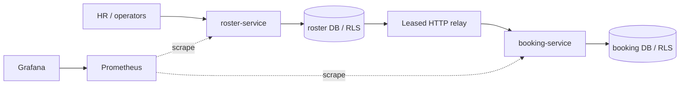

# HR Roster Sync — design note

HR sends full records with a tenant-wide `sourceSeq`; higher versions apply, older versions are ignored, and equal versions with different content conflict. A per-employee transaction lock serializes ingest, including creation versus deactivation before a row exists. Snapshot apply is atomic per tenant/source under an exclusive advisory lock. Booking state converges through at-least-once delivery with durable deduplication in the same transaction as cancellation and seat release.



PostgreSQL hosts two databases with separate owner and application roles. Runtime transactions set the tenant locally; forced RLS supplements explicit SQL scoping. Controllers authorize JWT roles, services own transactions, repositories hold SQL, and core policies are plain Java.

CSV parsing and COPY staging use bounded chunks plus a seen-ID set. Version-inclusive hashes partition rows into 65,536 buckets. Only mismatched buckets enter classification. Invalid/conflicting evidence suppresses inferred absences; a missing ratio of at least 30% blocks the whole apply. Approval is bound to the checksum and re-assessed missing set. Snapshot writes retain source-version guards; inferred deactivations are stamped at the cutoff.

```mermaid
sequenceDiagram
  participant O as HR / admin
  participant R as Roster
  participant D as PostgreSQL
  participant L as Relay
  participant B as Booking
  O->>R: CSV + cutoff + manifest
  R->>D: Stage; lock; digest; assess
  D-->>R: Brake: missing >= threshold
  R-->>O: Assessment + hash; zero mutations
  O->>R: Approve reviewed assessment
  R->>D: Re-lock; re-assess; atomic apply + history + outbox
  L->>D: Lease ordered events
  L->>B: Deliver with SERVICE JWT
  B->>B: Dedup + projection + cancellations + seat releases
  Note over B: Crash after commit, before acknowledgement
  L->>B: Retry same event ID
  B-->>L: DUPLICATE; effects retained once
  L->>D: Lease-guarded acknowledgement
```

| Failure | Visible result | Recovery |
|---|---|---|
| Replay / delayed version | DUPLICATE / STALE | No mutation |
| Conflicting identity/version | 409 | Correct the source |
| Invalid export evidence | Partial run; no inferred absences | Correct and resend |
| Truncated export | Brake or non-approvable row-count mismatch | Inspect, reject and resend |
| Changed approval assessment | Re-assessment required | Review the new hash |
| Crash during apply | Full rollback; retained STAGED run | Startup resubmits it |
| Crash after roster commit | Durable pending outbox | Relay resumes |
| Consumer crash after commit | Retry | Dedup preserves one effect |
| Consumer outage / dead letter | Backlog / blocked employee stream | Backoff, then operator replay |
| Database outage | 503 with Retry-After | Retry; transaction rollback |
| Cross-tenant access / stale admin edit | 404 / 409 | No disclosure; reload revision |

Atomic apply pauses tenant writes; downstream booking remains temporarily stale. On the measured host, typical digest/assessment/apply is about one second, but concurrent API p99 rises to about 1.1 seconds. At 1,000 HTTP events/s the relay accumulates backlog. See [measurements](benchmark.md), [decisions](decisions.md), [fault evidence](fault-runs/SUMMARY.txt), and [release validation](validation/README.md).
