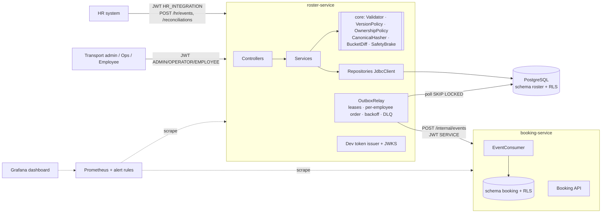

# Case Study 5 — HR Roster Sync: Complete Implementation Plan (v2)

**Scope:** everything the brief asks for — every hard rule, all eight Plus Points, all four Advanced Track requirements, and all eight submission instructions — with each item mapped to a design element and an automated proof. §1 is the line-by-line audit; if a line of the brief isn't there, it's a hole.

**Stack:** Java 21 · Spring Boot 4.1.x (latest patch from start.spring.io) · PostgreSQL (current major) · Flyway · Spring JDBC · Spring Security OAuth2 resource server (JWT) · Caffeine · Micrometer/Prometheus · Testcontainers 2.x · JUnit seeded randomized tests (no jqwik) · k6 · Docker Compose. **Build details are pinned in `AGENT_BUILD_SPEC.md`, which wins on any conflict.**

**Two deployable processes, one repository:**
- `roster-service`: HR ingest, reconciliation, field ownership, outbox, relay, token issuing for the demo.
- `booking-service`: bookings, seat reservations, employee projection, idempotent event consumer.

A real process boundary is what makes the "crash between commit and publish" and "crash between consumer commit and ack" tests genuine.

---

## 0. Design in one page

| Concern | Decision |
|---|---|
| Source contract | One **tenant-wide, monotonically increasing `sourceSeq`** per HR source (gaps allowed). Every event carries it. A nightly export declares `cutoffSeq = S` and each row carries its `lastChangeSeq ≤ S`. |
| Event semantics | **Full HR-owned state** per event, not patches (DEC-01). |
| Idempotency key | Event identity `(tenant, source, eventId)`. State identity `(tenant, source, employeeId, sourceSeq, hrHash)`. |
| Version comparison | Higher `sourceSeq` applies; lower is `STALE`; equal seq + equal hash is `DUPLICATE`; equal seq + different hash is `CONFLICT`; same eventId + different payload is `CONFLICT`. |
| Write primitive | One conditional upsert: `ON CONFLICT ... DO UPDATE ... WHERE current.source_seq < EXCLUDED.source_seq`, plus an outbox insert in the same transaction. |
| Ownership | Enforced structurally: HR SQL never names transport columns; HR DTOs reject transport fields; transport edits have their own endpoint and optimistic lock. |
| Deactivation | A versioned **tombstone**. Snapshot-inferred deactivations are stamped `source_seq = S`, so any older delayed event loses and can't resurrect the employee. |
| Nightly diff | Streamed parse + validate + canonical hash in Java → `COPY` to staging → **hashed buckets** (65,536 bucket digests per side, version included) → row-level diff only inside mismatched buckets. Bounded application memory. |
| Safety brake | `missing / baseline ≥ threshold` (default 0.30, per-tenant config) → `AWAITING_APPROVAL`, alert, **zero live mutations**. Approval is bound to the exact run, checksum and assessment. |
| Invalid snapshot rows | Valid rows still apply; **no absences are inferred** from a snapshot with any invalid or unidentifiable row (`PARTIAL_NO_DEACTIVATIONS`). |
| Snapshot vs live API race | Shared/exclusive transaction-scoped advisory lock per tenant source, **plus** `source_seq <= S` guards in every snapshot write (defence in depth). |
| Events out | Transactional outbox → relay (`FOR UPDATE SKIP LOCKED`, leases, per-employee ordering, backoff, dead letter) → HTTP to booking-service. At-least-once. |
| Consumer | One transaction: durable dedup (`processed_message`) + projection (revision-gated) + cancel future bookings + release seat reservations. Exactly-once **effect**. |
| Seats | Derived: capacity − active reservations. No counter to drift. |
| Security | JWT (RS256): roles `EMPLOYEE`, `ADMIN`, `OPERATOR`, plus service principals `HR_INTEGRATION`, `SERVICE`. Tenant from the token. **Postgres Row-Level Security** as a second isolation layer. |
| Not built (stated) | Kafka (the `EventPublisher` interface is the swap point), patch-event support, multi-source HR conflict resolution, PII encryption at rest, frontend beyond one static ops page. |

---

## 1. Coverage audit — every line of the brief

### 1.1 Case-specific requirements

| # | Brief line | Design (§) | Proof (test / artefact) |
|---|---|---|---|
| C1 | Changes arrive via API in near real time | `POST /hr/events`, `/hr/events/batch` (§8) | `IngestApiIT` |
| C2 | Full nightly export of up to 200,000 employees as a file | `POST /reconciliations` streaming upload (§6) | `ReconciliationIT`, benchmark |
| C3 | Updates arrive twice | Event identity + state identity (§4.3) | `DuplicateIT`, `ReplayIT`, property test |
| C4 | …arrive out of order | `sourceSeq` version gate (§5) | `OutOfOrderIT` (v7 then v6), property test |
| C5 | …contain bad data | Boundary validation, per-record report (§5.1) | `ValidationIT`, `RecordValidatorTest` |
| C6 | …are sometimes cut short | Manifest row count/checksum + safety brake (§6.2) | `TruncatedExportIT` |
| C7 | Some fields belong to HR, some to transport admin | Ownership table (§4.4) | `OwnershipIT` |
| C8 | Create, update, deactivate events with source version/timestamp | `eventType` UPSERT/DEACTIVATE + `sourceSeq` (§4.2) | `LifecycleIT` |
| C9 | Reject invalid records (malformed phone, unknown office) with per-record error report | `RecordValidator` + `record_error` table (§5.1) | `ValidationIT.malformedPhone`, `.unknownOffice` |
| C10 | One bad record never fails a whole batch | Per-record transactions (events); per-row staging status (files) | `BatchIT.oneBadRecordDoesNotFailBatch`, `ReconciliationIT.badRowDoesNotFailRun` |
| C11 | Apply changes per employee in version order | Conditional upsert (§5.2) | `OutOfOrderIT`, `ConcurrencyIT` |
| C12 | Stale update ignored | `STALE` outcome, no mutation | `OutOfOrderIT` |
| C13 | Duplicate is a no-op | `DUPLICATE` outcome, no mutation, no outbox row | `DuplicateIT` |
| C14 | HR owns name, email, manager, office | HR column list (§4.4) | `OwnershipIT` |
| C15 | Transport admin owns pickup point, special-assistance | Transport endpoint (§8) | `OwnershipIT` |
| C16 | HR update never overwrites a transport-owned field | Columns absent from HR SQL; DTO rejects them | `OwnershipIT.hrUpdateKeepsPickup`, `.hrPayloadWithPickupRejected` |
| C17 | The conflict rule is written down | DEC-06, DEC-07 + §4.4 table | `docs/decisions.md` |
| C18 | Compare 200k export with the store without loading both fully in memory (hash per record + hashed buckets) | Streamed staging + bucket digests (§6.3) | `ReconciliationBenchmarkIT` with capped heap |
| C19 | Safety brake: export missing 30% of active employees → stop | `SafetyBrake` before any live write (§6.4) | `SafetyBrakeIT` (299/1000, 300/1000, 400/1000) |
| C20 | …alert an operator | Metric + alert rule + WARN log + pending-approvals endpoint (§10) | `SafetyBrakeIT.alertRaised`, `ops/alerts.yml` |
| C21 | …deactivate nobody until a human approves | `AWAITING_APPROVAL`; approve endpoint, `ADMIN` role | `SafetyBrakeIT.nobodyDeactivatedBeforeApproval`, `.approveThenApplies` |
| C22 | Publish a change event for every applied change using the outbox pattern | Outbox insert in the same transaction as every applied mutation (§7.1) | `OutboxIT.oneEventPerAppliedChange`, `.rollbackTogether` |
| C23 | DB update and event can never disagree | Same transaction; at-least-once relay; idempotent consumer | `CrashAfterCommitBeforePublish` (process kill) |
| C24 | Deactivated employee: future bookings cancelled | booking-service consumer (§7.3) | `DeactivationIT.futureBookingsCancelled` |
| C25 | …and seat freed | Reservation release, derived capacity | `DeactivationIT.seatReleased`, `.noDoubleRelease` |
| C26 | Example: v7 transfer before v6 shift → shift ignored; new office with v7 shift | Full-record v7 + gate | `BriefExampleIT.transferBeforeShift` |
| C27 | Example: file cut at 120,000 rows → brake, nobody deactivated, operator sees how many records missing | Assessment stores `missingCount` and ratio | `BriefExampleIT.cutAt120k` |
| C28 | Define the idempotency key and the version comparison | §0 and §4.3; DEC-02 | design note |
| C29 | Test that replays the same feed twice and changes nothing | Snapshot hash of all business tables before/after | `ReplayIT.replayTwiceChangesNothing` |
| C30 | Brake threshold configurable | `tenant_config.brake_threshold` + property default | `SafetyBrakeIT.thresholdConfigurable` |
| C31 | Never write personal data into logs or error reports; use employee IDs | Allowlisted log fields; codes not values (§11) | `NoPiiIT` (canary scan) |
| C32 | Diff a 200,000-row snapshot in under 60 s with bounded memory | §12 | `docs/benchmark.md` |
| C33 | Test that crashes the process between the DB write and the event publish | Real SIGKILL (§13.4) | `scripts/kill-roster-after-commit.sh`, `CrashRecoveryIT` |

### 1.2 Plus Points (all eight)

| # | Plus Point | Where | Proof |
|---|---|---|---|
| P1 | Authentication, roles (employee/admin/operator), tenant isolation | §9: JWT, role matrix, tenant from token, Postgres RLS | `SecurityIT` (role matrix), `TenantIsolationIT` (API **and** RLS layers) |
| P2 | Time/space complexity + benchmark + where it stops scaling | §14 | `docs/benchmark.md`, design note |
| P3 | Crashes, timeouts, duplicate/out-of-order messages, partial failures; failure-injection test | §13 | 5 process-level fault scripts + DB-pause test |
| P4 | OOP: encapsulation, inheritance, polymorphism, controller/service/repository | §3.2 | code structure; `core` package tests without Spring |
| P5 | Trade-offs: consistency vs availability vs latency; what's left out | §15 | README + design note |
| P6 | Metrics + structured logging; lag, error rate, rejections, retries, queue depth | §10 | `/actuator/prometheus`, `ops/alerts.yml`, Grafana dashboard |
| P7 | Caching with eviction; what's stale, how long, how bounded | §11.3 | `CacheIT`, README table |
| P8 | Error framework, non-leaking messages, no PII in logs or responses | §11 | `ErrorContractIT`, `NoPiiIT` |

### 1.3 Advanced Track (all four)

| # | Requirement | Where | Proof |
|---|---|---|---|
| A1 | Every hard rule has an automated test, incl. ≥1 concurrency and ≥1 failure test | §1.1 proof column; §13 | `./mvnw verify` report; 6 concurrency tests, 6 failure tests |
| A2 | Load test/benchmark with throughput and p50/p99, machine stated | §12 | `docs/benchmark.md`, README table |
| A3 | 1–2 page design note: architecture diagram, sequence diagram (hardest flow), failure-mode table | §16 | `docs/design-note.md` |
| A4 | One-command run incl. DB | §17 | `docker compose up --build` |

### 1.4 Submission instructions (all eight)

| # | Instruction | Where |
|---|---|---|
| I1 | Understand requirements, hard rules, scale | §1 audit |
| I2 | Language choice defended | Java/Spring (preferred); README one paragraph |
| I3 | Design first: data model, components, APIs, failure modes in the design note | §2–§8, §16 |
| I4 | Clean layered code, core algorithm in plain classes testable without web/DB | §3.2 `core` package |
| I5 | Normal + edge-case tests; unit, concurrency, failure, benchmark | §13 |
| I6 | README: how to run, assumptions, benchmark results, trade-offs | §17.2 |
| I7 | Public GitHub repo, meaningful commit history | §17.3 |
| I8 | Demo video: main flows, one live failure, sample API calls (Postman/curl) | §18 + `postman/collection.json` |

---

## 2. Decision log (`docs/decisions.md`)

Template per entry: **Context · Decision · Rejected alternative · Consequence.**

| ID | Decision | One-line rationale |
|---|---|---|
| DEC-01 | Events carry full HR-owned state | Only safe basis for "ignore stale"; patches would need per-field versions |
| DEC-02 | Tenant-wide monotonic `sourceSeq` (gaps allowed) | Makes events and snapshots comparable; timestamps can tie or skew |
| DEC-03 | Deactivation is a versioned tombstone; reactivation needs a higher seq | Old events can't resurrect; lifecycle is explicit |
| DEC-04 | Snapshot declares `cutoffSeq`; only employees with `source_seq ≤ S` can be inferred absent | A newer API change after the export was cut always survives |
| DEC-05 | Brake: `baseline>0 ∧ missing/baseline ≥ threshold`, exact rational comparison | Testable boundary; empty baseline never authorises deactivation |
| DEC-06 | HR create for an existing employee (re-hire) keeps transport fields | Transport data is the admin's, not HR's, to clear |
| DEC-07 | Office transfer keeps pickup point but emits `PICKUP_REVIEW_NEEDED` | Auto-clearing would destroy admin data; ignoring would be unsafe |
| DEC-08 | Any invalid/unidentifiable row ⇒ no inferred absences for that run | Validation errors must never cause deactivations |
| DEC-09 | Manifest row-count mismatch ⇒ run can't be approved; re-upload required | A truncated file can't be made complete by clicking approve |
| DEC-10 | Reconciliation apply is one atomic transaction under an exclusive tenant lock | No partial runs; costs a seconds-long write pause per tenant (measured) |
| DEC-11 | HTTP push to booking-service, at-least-once; dedup in consumer | Real process boundary without operating a broker |
| DEC-12 | Per-employee delivery order in the relay | Prevents reactivation overtaking deactivation |
| DEC-13 | "Future booking" = scheduled start > deactivation `effectiveAt` and status `RESERVED` | In-progress and completed trips are never touched |
| DEC-14 | Reactivation does not restore cancelled bookings | Keeps cancellation idempotent and explainable |
| DEC-15 | Equal `sourceSeq` with different content ⇒ `CONFLICT`, never silently resolved | Two truths for one version is a source bug to surface |
| DEC-16 | JWT issued by a dev-only endpoint in roster-service | Robust validation path without running a separate identity provider |

---

## 3. Architecture

### 3.1 Components



### 3.2 Code structure (layering + OOP)

```
roster-service/src/main/java/.../roster
├── api/            EmployeeController, HrEventController, ReconciliationController, TransportController,
│                   OutboxAdminController, dto/*, GlobalExceptionHandler (ProblemDetail)
├── core/           // PURE JAVA — no Spring, no JDBC
│   ├── event/      sealed interface HrEvent permits UpsertEvent, DeactivateEvent
│   ├── policy/     VersionPolicy, OwnershipPolicy, SafetyBrake, LifecyclePolicy
│   ├── validate/   RecordValidator, rules/* (PhoneRule, EmailRule, OfficeRule …) — Strategy
│   ├── hash/       CanonicalHasher (SHA-256 of normalised HR fields), Bucketer
│   └── diff/       BucketDigest, BucketDiff
├── service/        HrEventService, ReconciliationService, TransportFieldService, ApprovalService
├── repository/     EmployeeRepository, StagingRepository (CopyManager), OutboxRepository,
│                   RunRepository, ErrorRepository, TenantConfigRepository
├── outbox/         OutboxRelay, EventPublisher (interface), HttpEventPublisher, KafkaEventPublisher (stub)
├── security/       SecurityConfig, TenantContext, RlsConnectionCustomizer, DevTokenIssuer
├── cache/          OfficeCatalog (interface), CaffeineOfficeCatalog
└── observability/  Metrics, MdcFilter, LogRedaction
booking-service/... api/, core/ (CancellationPolicy), service/, repository/, consumer/
```

- **Encapsulation:** `EmployeeState` is an immutable record; changes happen through `LifecyclePolicy.apply(current, event) → Decision`. No setters.
- **Inheritance / polymorphism:**
  - `sealed interface HrEvent` with `UpsertEvent` and `DeactivateEvent`.
  - `abstract class ValidationRule<T>` with concrete rules.
  - `EventHandler` strategies chosen by `EventHandlerFactory` (the factory pattern).
  - `EventPublisher` with HTTP and Kafka implementations.
  - `OfficeCatalog` with Caffeine (and a Redis-ready interface).
- **Layering:** controllers call services only; services own transactions (`TransactionTemplate` on separate beans to avoid the self-invocation trap); repositories hold all SQL.

---

## 4. Contracts

### 4.1 Event payload

```json
{
  "eventId": "hr-evt-000123",
  "sourceSeq": 1007,
  "eventType": "UPSERT",
  "employeeId": "EMP-042",
  "effectiveAt": "2026-10-30T08:00:00Z",
  "hr": {
    "name": "Synthetic Employee", "email": "emp042@example.test", "phone": "+919000000042",
    "managerId": "EMP-001", "officeCode": "BLR-A", "shiftCode": "EVENING", "active": true
  }
}
```

`DEACTIVATE` events carry `employeeId`, `sourceSeq`, `effectiveAt` and no `hr` block. Unknown JSON properties are rejected (`FAIL_ON_UNKNOWN_PROPERTIES`), so `pickupPoint` in an HR payload is a 422.

### 4.2 Export file and manifest

- Format: CSV (RFC 4180), header `employee_id,name,email,phone,manager_id,office_code,shift_code,last_change_seq`.
- Manifest (multipart part or headers): `sourceId`, `cutoffSeq`, `expectedRows` (optional but recommended), `sha256` (optional).
- Every row's `last_change_seq` must be ≤ `cutoffSeq`; otherwise the row is invalid (`SEQ_AFTER_CUTOFF`).

### 4.3 Keys and outcomes

| Situation | Outcome | Mutation | Outbox |
|---|---|---|---|
| New eventId, seq > stored (or no row) | `APPLIED` | yes | 1 row |
| Same eventId, same payload hash | `DUPLICATE` | no | none |
| Same eventId, different payload hash | `CONFLICT` (409 / per-record) | no | none |
| New eventId, seq < stored | `STALE` | no | none |
| New eventId, seq = stored, same hrHash | `DUPLICATE` | no | none |
| New eventId, seq = stored, different hrHash | `CONFLICT` | no | none |
| Seq ≤ tenant's reconciled absence watermark for an employee absent from that snapshot | `STALE` (no resurrection) | no | none |
| Invalid payload | `REJECTED` + codes | no | none |

### 4.4 Field ownership (conflict rule)

| Field | Owner | HR event | Transport admin | Notes |
|---|---|---|---|---|
| name, email, phone, manager_id, office_code, shift_code, active | HR | write (if newer) | 403 `FIELD_NOT_OWNED` | phone/shift/active assigned to HR by DEC (brief lists name/email/manager/office) |
| pickup_point, special_assistance | Transport admin | **never written**; payload containing them → 422 | write with `If-Match: aggregate_revision` | Kept across deactivation and re-hire |
| tenant_id, employee_id, source_seq, aggregate_revision, timestamps | System | derived | derived | |

`aggregate_revision` increments on **every** applied mutation (HR or admin) and orders events downstream. `source_seq` changes only via HR.

### 4.5 Data model (Flyway, schema `roster`; booking-service owns schema `booking`)

```sql
CREATE TABLE tenant_source (
  tenant_id text, source_id text, lock_key bigint NOT NULL UNIQUE,      -- advisory-lock key, collision-free
  accepted_snapshot_cutoff bigint NOT NULL DEFAULT 0,
  absence_watermark        bigint NOT NULL DEFAULT 0,                    -- last cutoff that inferred absences
  PRIMARY KEY (tenant_id, source_id));
CREATE TABLE tenant_config (tenant_id text PRIMARY KEY, brake_threshold_bp int NOT NULL DEFAULT 3000);
CREATE TABLE office (tenant_id text, office_code text, active boolean NOT NULL DEFAULT true,
  PRIMARY KEY (tenant_id, office_code));
CREATE TABLE employee (
  tenant_id text, source_id text, employee_id text,
  name text NOT NULL, email text NOT NULL, phone text NOT NULL, manager_id text,
  office_code text NOT NULL, shift_code text NOT NULL, active boolean NOT NULL,
  source_seq bigint NOT NULL, hr_hash bytea NOT NULL, bucket int NOT NULL,          -- 0..65535
  pickup_point text, special_assistance text,                              -- transport-owned
  aggregate_revision bigint NOT NULL, tombstone_reason text,
  updated_at timestamptz NOT NULL DEFAULT now(),
  PRIMARY KEY (tenant_id, source_id, employee_id),
  FOREIGN KEY (tenant_id, office_code) REFERENCES office);
CREATE INDEX employee_bucket_active ON employee (tenant_id, source_id, bucket) WHERE active;
CREATE TABLE ingest_event (id bigserial PRIMARY KEY, tenant_id text, source_id text, event_id text,
  payload_hash bytea NOT NULL, employee_id text, source_seq bigint, outcome text,
  error_codes text[], created_at timestamptz NOT NULL DEFAULT now(),
  UNIQUE (tenant_id, source_id, event_id));
CREATE TABLE employee_history (id bigserial PRIMARY KEY, tenant_id text, employee_id text,
  source_seq bigint, aggregate_revision bigint, change text, origin text,      -- API/RECONCILIATION/ADMIN
  run_id uuid, created_at timestamptz NOT NULL DEFAULT now());
CREATE TABLE reconciliation_run (run_id uuid PRIMARY KEY, tenant_id text, source_id text,
  cutoff_seq bigint NOT NULL, file_sha256 bytea, expected_rows int, parsed_rows int, valid_rows int,
  invalid_rows int, unidentifiable_rows int, status text NOT NULL, flags text[],
  baseline int, missing int, ratio_bp int, assessment_hash bytea, missing_sample text[],
  approved_by text, approval_reason text, approved_at timestamptz,
  counts jsonb, phase_ms jsonb, created_at timestamptz NOT NULL DEFAULT now());
CREATE UNIQUE INDEX one_active_run ON reconciliation_run (tenant_id, source_id)
  WHERE status IN ('UPLOADING','STAGED','APPLYING');
CREATE TABLE staging_employee (run_id uuid, row_no int, employee_id text, name text, email text,
  phone text, manager_id text, office_code text, shift_code text, last_change_seq bigint,
  hr_hash bytea, bucket int, valid boolean NOT NULL, error_codes text[],
  PRIMARY KEY (run_id, employee_id));                                        -- presence includes invalid rows
CREATE TABLE record_error (id bigserial PRIMARY KEY, tenant_id text, run_id uuid, event_id text,
  row_no int, employee_id text, field text, code text NOT NULL);            -- never the rejected value
CREATE TABLE operator_alert (id bigserial PRIMARY KEY, tenant_id text, kind text, run_id uuid,
  details jsonb, acknowledged_by text, created_at timestamptz NOT NULL DEFAULT now());
CREATE TABLE outbox_event (id bigserial PRIMARY KEY, event_id uuid NOT NULL UNIQUE, tenant_id text,
  employee_id text, aggregate_revision bigint NOT NULL, event_type text NOT NULL, payload jsonb NOT NULL,
  state text NOT NULL DEFAULT 'PENDING', lease_token uuid, lease_until timestamptz,
  attempts int NOT NULL DEFAULT 0, next_attempt_at timestamptz NOT NULL DEFAULT now(),
  last_error_code text, created_at timestamptz NOT NULL DEFAULT now(), delivered_at timestamptz,
  UNIQUE (tenant_id, employee_id, aggregate_revision));
CREATE INDEX outbox_due ON outbox_event (next_attempt_at) WHERE state IN ('PENDING','RETRY');
-- booking schema
CREATE TABLE employee_projection (tenant_id text, employee_id text, active boolean NOT NULL,
  last_revision bigint NOT NULL, effective_at timestamptz, PRIMARY KEY (tenant_id, employee_id));
CREATE TABLE trip (trip_id uuid PRIMARY KEY, tenant_id text, capacity int NOT NULL, starts_at timestamptz);
CREATE TABLE booking (booking_id uuid PRIMARY KEY, tenant_id text, employee_id text, trip_id uuid,
  scheduled_start timestamptz NOT NULL, status text NOT NULL, cancelled_reason text, cancelled_by_event uuid);
CREATE INDEX booking_emp ON booking (tenant_id, employee_id, status, scheduled_start);
CREATE TABLE seat_reservation (booking_id uuid PRIMARY KEY REFERENCES booking, trip_id uuid, seat_no int,
  state text NOT NULL, released_at timestamptz);
CREATE UNIQUE INDEX seat_active ON seat_reservation (trip_id, seat_no) WHERE state = 'ACTIVE';
CREATE TABLE processed_message (consumer text, event_id uuid, outcome text,
  processed_at timestamptz NOT NULL DEFAULT now(), PRIMARY KEY (consumer, event_id));
-- every tenant table: ALTER TABLE … ENABLE/FORCE ROW LEVEL SECURITY + tenant_isolation policy (§9)
```

---

## 5. Event ingestion

### 5.1 Validation at the boundary

`RecordValidator` (pure) runs a list of `ValidationRule`s and returns `List<ErrorCode>`; values are never echoed.
- **Rules:** `EMPLOYEE_ID_FORMAT` (`[A-Za-z0-9_-]{1,64}`), `EMAIL_FORMAT`, `PHONE_E164` (`^\+[1-9]\d{7,14}$`), `OFFICE_UNKNOWN` (catalog lookup, §11.3), `SHIFT_UNKNOWN`, `SEQ_NOT_POSITIVE`, `MANAGER_SELF_REFERENCE`, `FIELD_TOO_LONG`, `UNKNOWN_FIELD`.
- **Batch:** `/hr/events/batch` accepts NDJSON up to 1,000 events. Each event gets its own transaction, and the response lists per-record outcomes. HTTP 200 doesn't mean every record applied.

### 5.2 Apply transaction (one per event)

```
BEGIN;
SELECT pg_advisory_xact_lock_shared(:tenantSourceLockKey);           -- waits only for a reconciliation apply
SET LOCAL app.tenant_id = :tenant;                                    -- RLS
INSERT INTO ingest_event(tenant_id, source_id, event_id, payload_hash, employee_id, source_seq)
  VALUES (...) ON CONFLICT DO NOTHING RETURNING id;                   -- 0 rows → compare payload_hash → DUPLICATE/CONFLICT
-- resurrection guard: if NO employee row exists and :seq <= tenant_source.absence_watermark → STALE
-- (that snapshot proved the employee absent; an existing tombstone already has source_seq = S, so the gate below handles it)
WITH upserted AS (
  INSERT INTO employee AS cur (tenant_id, source_id, employee_id, source_seq, hr_hash, bucket,
         name, email, phone, manager_id, office_code, shift_code, active, aggregate_revision)
  VALUES (:t, :s, :id, :seq, :hash, :bucket, :name, :email, :phone, :mgr, :office, :shift, :active, 1)
  ON CONFLICT (tenant_id, source_id, employee_id) DO UPDATE SET
     source_seq = EXCLUDED.source_seq, hr_hash = EXCLUDED.hr_hash,
     name = EXCLUDED.name, email = EXCLUDED.email, phone = EXCLUDED.phone,
     manager_id = EXCLUDED.manager_id, office_code = EXCLUDED.office_code,
     shift_code = EXCLUDED.shift_code, active = EXCLUDED.active,
     aggregate_revision = cur.aggregate_revision + 1, tombstone_reason = NULL
  WHERE cur.source_seq < EXCLUDED.source_seq          -- THE version gate; transport columns never named
  RETURNING tenant_id, employee_id, aggregate_revision, active, (xmax = 0) AS inserted
)
INSERT INTO outbox_event (event_id, tenant_id, employee_id, aggregate_revision, event_type, payload)
SELECT gen_random_uuid(), tenant_id, employee_id, aggregate_revision,
       CASE WHEN inserted THEN 'EmployeeCreated' WHEN NOT active THEN 'EmployeeDeactivated' ELSE 'EmployeeUpdated' END,
       jsonb_build_object('employeeId', employee_id, 'aggregateRevision', aggregate_revision,
                          'active', active, 'effectiveAt', :effectiveAt, 'changedFields', :changedFieldNames)
FROM upserted
RETURNING employee_id;
-- 0 rows → read stored seq/hash → STALE / DUPLICATE / CONFLICT
UPDATE ingest_event SET outcome = :outcome WHERE id = :ingestId;
COMMIT;
```

- **Why it's race-safe:** Postgres takes the row lock on conflict and re-evaluates the `WHERE` against the latest committed row. Concurrent v6 and v7 always end at v7, in either commit order. If v6 commits first, both apply; that's correct.
- **`DeactivateEvent`** uses `DeactivateHandler` with its own statement, the same gate, and the outbox CTE:
  ```sql
  UPDATE employee SET active = false, source_seq = :seq, tombstone_reason = 'HR_DEACTIVATED',
         aggregate_revision = aggregate_revision + 1
  WHERE tenant_id = :t AND source_id = :s AND employee_id = :id AND source_seq < :seq
  RETURNING ...
  ```
  Unknown employee → stored as a **tombstone** (`employee_tombstone`, outcome `TOMBSTONED`), so a later, lower-seq create can't bring them back (order independence; see `AGENT_BUILD_SPEC.md` §7.4).
- **Reactivation** (`UpsertEvent` with `active=true` after a tombstone) needs a higher seq than the tombstone; its outbox type is `EmployeeReactivated`.
- **Lock waits vs timeouts:** API transactions set `lock_timeout = 3s`. If a reconciliation apply holds the exclusive tenant lock longer, the API returns 503 `RECONCILIATION_IN_PROGRESS` with `Retry-After`. That's the availability cost of DEC-10, measured in the contention run (§12).
- **Transport-admin edit:**
  ```sql
  UPDATE employee SET pickup_point = ?, special_assistance = ?, aggregate_revision = aggregate_revision + 1
  WHERE tenant_id = ? AND employee_id = ? AND aggregate_revision = :ifMatch
  ```
  0 rows → 409. Also inserts an `EmployeeTransportUpdated` outbox row.

---

## 6. Nightly reconciliation

### 6.1 Lifecycle

```
UPLOADING → STAGED → (ASSESSING) → AWAITING_APPROVAL ─approve→ APPLYING → COMPLETED
                                 ↘ APPLYING → COMPLETED | PARTIAL_NO_DEACTIVATIONS
UPLOADING/STAGED → INCOMPLETE (checksum/row-count/structure)        any → FAILED (rolled back, retryable)
AWAITING_APPROVAL → REJECTED (operator)
```

At most one active run per tenant source (partial unique index on `status IN ('UPLOADING','STAGED','APPLYING')`).

### 6.2 Upload and stage (streamed)

1. Stream the multipart body through a `DigestInputStream` (SHA-256) and a CSV parser (Apache Commons CSV) row by row. The whole file is never held.
2. Per row: validate (§5.1 rules + `SEQ_AFTER_CUTOFF`), canonicalise HR fields, compute `hr_hash` and `bucket`. Write a line to a `PipedOutputStream` that feeds `CopyManager.copyIn("COPY staging_employee FROM STDIN (FORMAT csv)")`. Invalid but identifiable rows are staged with `valid=false` and their codes. Unidentifiable rows (no parseable `employee_id`) increment `unidentifiable_rows`.
3. Exact duplicate employee rows collapse; conflicting duplicates → both marked `DUPLICATE_ROW_CONFLICT`.
4. At the end, compare `expectedRows` and `sha256` if provided. A mismatch or structural CSV error → `INCOMPLETE` (can't be approved; DEC-09). Otherwise `STAGED`.
5. `ANALYZE staging_employee` for the run.

**Memory:** constant. One row is in flight; the pipe buffer is 64 KB.

### 6.3 Hash-per-record + hashed buckets diff

- `bucket = first 2 bytes of SHA-256(employee_id)` (0..65,535). Stable across JVMs and Postgres versions; stored in both `employee` and `staging_employee`. Each digest element includes the row's **sequence number**, so a same-HR, higher-version snapshot row is detected.
- Bucket digests (both sides, one SQL each, up to 65,536 rows returned; exact SQL including the version is in `AGENT_BUILD_SPEC.md` §9.3):
  ```sql
  SELECT bucket, sha256(string_agg(convert_to(employee_id, 'UTF8') || hr_hash, ''::bytea ORDER BY employee_id))
  FROM staging_employee WHERE run_id = :run AND valid GROUP BY bucket;
  SELECT bucket, sha256(string_agg(convert_to(employee_id, 'UTF8') || hr_hash, ''::bytea ORDER BY employee_id))
  FROM employee WHERE tenant_id = :t AND source_id = :s AND active GROUP BY bucket;
  ```
- `BucketDiff` (pure Java) compares the two 65,536-entry maps → `mismatchedBuckets`. Unchanged buckets are skipped entirely.
  - Honest expectation: with 10,000 changed IDs about 14% of buckets are touched; on a quiet night (~100 changes) under 1%; on a heavy night nearly all.
  - With 1,024 buckets, a typical night would touch every bucket, which is why 65,536 is used. Exact SQL is in `AGENT_BUILD_SPEC.md` §9.3.
- Row-level classification runs only for `bucket = ANY(:mismatched)`, as set-based SQL inside the apply transaction (§6.5).
- **Reported:** buckets total/mismatched, rows compared, time per phase.

### 6.4 Safety assessment (under the exclusive tenant lock)

```
BEGIN; SELECT pg_advisory_xact_lock(:tenantSourceLockKey);   -- waits for in-flight writers; blocks new ones
baseline = count(active employees with source_seq <= S)
present  = staging rows (valid or invalid-but-identifiable)
missing  = baseline employees not in present
brake    = baseline > 0 AND missing * 10000 >= threshold_bp * baseline     -- exact integer comparison
flags    = {MISSING_RATIO_EXCEEDED?, ROW_COUNT_MISMATCH?, INVALID_ROWS_PRESENT?, UNIDENTIFIABLE_ROWS?}
```

- **Brake tripped:** store `baseline`, `missingCount`, ratio, flags, a sample of 20 missing IDs and the checksum. Status `AWAITING_APPROVAL`; increment `roster_safety_brake_trips_total`; WARN log `{runId, tenantId, missingCount, ratioBp}`; insert an `operator_alert` row. **COMMIT with zero live mutations.**
- **Approval** (`ADMIN`, with reason, `runId` and the `assessmentHash` the operator saw): re-acquire the exclusive lock, recompute the assessment, and apply only if `assessmentHash` is unchanged. Otherwise the approval is invalid and the new assessment must be approved.
- A run flagged `ROW_COUNT_MISMATCH` or `INCOMPLETE` can't be approved (DEC-09).

### 6.5 Apply (same transaction as the final assessment)

All statements are restricted to mismatched buckets, guarded by `source_seq`, and feed the outbox through `RETURNING` CTEs:

1. **New:** valid staged rows with no employee row → insert (seq = `last_change_seq`).
2. **Changed:** `staged.last_change_seq > employee.source_seq` → update HR columns only.
3. **Version-only advance:** same hash, higher seq → advance seq and revision; event `EmployeeVersionAdvanced` (consumer updates projection only).
4. **Stale / equal:** counted, not applied. Equal seq with different hash → `CONFLICT` row error.
5. **Missing** (only when no `INVALID_ROWS_PRESENT`/`UNIDENTIFIABLE_ROWS` flags; DEC-08):
   ```sql
   UPDATE employee SET active = false, source_seq = :S, tombstone_reason = 'ABSENT_IN_SNAPSHOT', aggregate_revision = aggregate_revision + 1
   WHERE tenant_id = :t AND source_id = :s AND active AND source_seq <= :S
     AND bucket = ANY(:mismatched)
     AND NOT EXISTS (SELECT 1 FROM staging_employee st WHERE st.run_id = :run AND st.employee_id = employee.employee_id)
   RETURNING ...   -- → outbox EmployeeDeactivated
   ```
   The `source_seq <= :S` guard means a newer API change is never deactivated, even without the lock.
6. Update `tenant_source.absence_watermark = S` (only for runs that inferred absences) and `accepted_snapshot_cutoff = S`. Set run counts and status. **COMMIT.**

**Failure mid-apply:** the transaction rolls back completely (no partial run, no orphan outbox rows); staging is kept; retry is safe. The exclusive lock is transaction-scoped and released by rollback or crash. Measure and report lock hold time (`roster_reconciliation_lock_seconds`).

**Lineage:** a snapshot with `cutoffSeq` below `accepted_snapshot_cutoff` → `STALE_SNAPSHOT` (rejected before staging).

---

## 7. Outbox, relay and booking-service

### 7.1 Outbox table semantics

- One row per applied mutation, inserted in the same transaction.
- Payload holds **IDs, revision, active flag, effectiveAt, changed field names only**. No names, emails, phones or pickup coordinates.

### 7.2 Relay protocol (roster-service)

1. **Claim** (short transaction):
   ```sql
   WITH next AS (
     SELECT o.id FROM outbox_event o
     WHERE o.state IN ('PENDING','RETRY') AND o.next_attempt_at <= now()
       AND NOT EXISTS (SELECT 1 FROM outbox_event p                       -- per-employee order (DEC-12)
                       WHERE p.tenant_id = o.tenant_id AND p.employee_id = o.employee_id
                         AND p.aggregate_revision < o.aggregate_revision AND p.state <> 'DELIVERED')
     ORDER BY o.id LIMIT 100 FOR UPDATE SKIP LOCKED)
   UPDATE outbox_event SET state = 'CLAIMED', lease_token = :token, lease_until = now() + interval '30 seconds'
   WHERE id IN (SELECT id FROM next) RETURNING *;
   ```
   Expired leases (`CLAIMED` with `lease_until < now()`) are reclaimable. A `DEAD` predecessor deliberately blocks that employee's later events until an operator replays it, so a reactivation can never overtake a stuck deactivation. Unrelated employees are unaffected. Surfaced by `outbox_dead_total` and the `OutboxDeadLetters` alert.
2. **Send** outside any transaction: `POST booking-service/internal/events` with a service JWT, `Idempotency-Key: eventId`. Connect timeout 1 s, read timeout 3 s, bounded pool of 4.
3. **Ack:** `UPDATE ... SET state='DELIVERED' WHERE id=? AND lease_token=?`. A stale worker can't ack.
4. **Failure:** `attempts+1`, `next_attempt_at = now() + min(2^attempts s, 5 min) ± 20% jitter`. After 10 attempts → `DEAD` (visible, alerting, replayable with the same eventId via `POST /outbox/{id}/replay`, `OPERATOR`).
5. **Retention:** delivered rows are purged after 7 days. Dedup in the consumer is kept for 30 days, longer than the maximum replay horizon (stated).

`SKIP LOCKED` lets several relay workers split the queue; it does **not** prevent duplicate delivery. The consumer does that.

### 7.3 Consumer (booking-service), one transaction

```
BEGIN; SET LOCAL app.tenant_id = :tenant;
INSERT INTO processed_message(consumer, event_id) VALUES ('booking', :eventId) ON CONFLICT DO NOTHING;
  -- 0 rows → already processed → COMMIT; return 200
SELECT ... FROM employee_projection WHERE tenant_id=? AND employee_id=? FOR UPDATE;
IF :aggregateRevision <= projection.last_revision → record SKIPPED_OLDER; COMMIT; return 200
UPSERT projection (active, last_revision, effective_at)
IF deactivated:
  UPDATE booking SET status='CANCELLED', cancelled_reason='EMPLOYEE_DEACTIVATED', cancelled_by_event=:eventId
  WHERE tenant_id=? AND employee_id=? AND status='RESERVED' AND scheduled_start > :effectiveAt
  RETURNING booking_id;
  UPDATE seat_reservation SET state='RELEASED', released_at=now() WHERE booking_id = ANY(:cancelled) AND state='ACTIVE';
COMMIT; return 200
```

- **Seats available** = `trip.capacity − count(active reservations)`. A partial unique index on `(trip_id, seat_no) WHERE state='ACTIVE'` is the last guard.
- **Booking creation** locks the employee projection row and requires `active`. That closes the race with a concurrent deactivation (`BookingRaceIT`).
- **Eventual consistency window:** between the roster commit and consumer delivery, a booking for a just-deactivated employee may still be accepted. It is then cancelled by the event. Measured as `outbox_delivery_lag_seconds`; stated in trade-offs.

---

## 8. API

All under `/api/v1`. Tenant comes from the JWT only. Long operations return `202` with a run ID to poll.

| Method | Path | Roles | Purpose |
|---|---|---|---|
| POST | `/auth/token` | public (dev profile only) | Exchange demo username/password for a JWT |
| GET | `/.well-known/jwks.json` | public | Public key for booking-service |
| POST | `/hr/events` | HR_INTEGRATION | One event → outcome |
| POST | `/hr/events/batch` | HR_INTEGRATION | ≤1,000 NDJSON events → per-record outcomes |
| POST | `/reconciliations` | HR_INTEGRATION, OPERATOR | Upload file + manifest → `202 {runId}` |
| GET | `/reconciliations/{id}` | OPERATOR, ADMIN | Status, counts, phase timings, assessment, flags |
| GET | `/reconciliations/{id}/errors?page=` | OPERATOR, ADMIN | Row number, employeeId, field, code (no values) |
| GET | `/reconciliations/pending-approval` | OPERATOR, ADMIN | Alert inbox |
| POST | `/reconciliations/{id}/approve` | ADMIN | `{assessmentHash, reason}` |
| POST | `/reconciliations/{id}/reject` | ADMIN, OPERATOR | `{reason}` |
| GET | `/employees/{id}` | ADMIN, OPERATOR; EMPLOYEE (self only) | Current state + revisions |
| GET | `/employees/{id}/history` | ADMIN | Version timeline (outcomes, seq, revision) |
| PATCH | `/employees/{id}/transport` | ADMIN | Pickup/assistance, `If-Match` |
| DELETE | `/employees/{id}` | ADMIN | Admin deactivation (next revision; emits event) |
| GET | `/outbox/status` | OPERATOR | Pending, claimed, retry, dead, oldest age |
| POST | `/outbox/{id}/replay` | OPERATOR | Re-queue a dead event (same eventId) |
| booking-service | `POST /internal/events` | SERVICE | Consumer endpoint |
| booking-service | `POST /bookings`, `GET /bookings/{id}`, `GET /trips/{id}/seats` | EMPLOYEE (self), ADMIN | Create/see bookings and free seats |
| both | `/actuator/health`, `/actuator/prometheus` | public / OPERATOR | Ops |

`postman/collection.json` + `postman/environment.json` cover every endpoint. The README has equivalent `curl` lines.

---

## 9. Security and tenant isolation (P1)

- **Tokens:** RS256 JWTs, 15-min expiry, claims `sub`, `tenant`, `roles`, `iss`, `aud`. Both services are configured as OAuth2 resource servers and validate signature, `iss`, `aud` and `exp`. The issuer endpoint exists only in the `dev` profile (DEC-16); production would point at the company IdP.
- **Demo users** (BCrypt-hashed, seeded): `hr@acme`, `admin@acme`, `ops@acme`, `emp042@acme` (EMPLOYEE bound to `EMP-042`), and the same set for `globex`.

**Role matrix (tested cell by cell in `SecurityIT`):**

| Action | EMPLOYEE | OPERATOR | ADMIN | HR_INTEGRATION | SERVICE |
|---|---|---|---|---|---|
| Send HR events / upload export | – | upload only | – | ✓ | – |
| Read own employee record | ✓ | ✓ | ✓ | – | – |
| Read others' records | – | ✓ | ✓ | – | – |
| Edit transport fields | – | – | ✓ | – | – |
| Approve/reject brake | – | reject | ✓ | – | – |
| Outbox status/replay | – | ✓ | – | – | – |
| Consume events | – | – | – | – | ✓ |

**Two isolation layers:**
1. Every repository method takes `tenantId`. Another tenant's resource → **404** (no existence leak).
2. **Postgres Row-Level Security** on every tenant table: `CREATE POLICY tenant_isolation USING (tenant_id = current_setting('app.tenant_id'))`, `FORCE ROW LEVEL SECURITY`, app role ≠ table owner. Each transaction runs `SET LOCAL app.tenant_id`.

`TenantIsolationIT.rlsBlocksEvenUnscopedQuery` deliberately runs an unscoped `SELECT` as tenant A and asserts zero tenant-B rows.

---

## 10. Monitoring (P6) — what on-call needs at 3 AM

**Structured logs:** `logging.structured.format.console=ecs`. MDC: `traceId`, `tenantId`, `runId`, `eventId`, `employeeId`, `outcome`. Never names, emails, phones, payloads or SQL bind values (§11).

| Metric | Type | Answers |
|---|---|---|
| `roster_events_total{outcome}` | counter | Error/rejection rate, replay storms |
| `roster_event_apply_seconds` | histogram | p50/p99 latency |
| `roster_validation_rejections_total{code}` | counter | Bad data by cause (bounded codes) |
| `outbox_queue_depth{state}` | gauge | **Queue depth** |
| `outbox_oldest_pending_age_seconds` | gauge | **Lag** |
| `outbox_delivery_attempts_total{result}`, `outbox_retries_total`, `outbox_dead_total` | counter | **Retries**, dead letters |
| `outbox_delivery_lag_seconds` | histogram | Commit → consumer ack |
| `booking_consumer_events_total{result=processed/duplicate/skipped_older}` | counter | Dedup working |
| `booking_cancellations_total`, `booking_seats_released_total` | counter | Side effects |
| `reconciliation_phase_seconds{phase}` | histogram | upload/stage/digest/assess/apply |
| `reconciliation_runs_total{status}`, `roster_safety_brake_trips_total` | counter | Nightly health |
| `roster_reconciliation_lock_seconds` | histogram | Write-pause cost (DEC-10) |
| `cache_gets_total{cache,result}`, `cache_evictions_total` | auto | Cache health |

**`ops/alerts.yml` (Prometheus rules):** `SafetyBrakeTripped` (increase > 0), `OutboxLagHigh` (oldest pending > 60 s for 5 m), `OutboxDeadLetters` (> 0), `ReconciliationFailed`, `ValidationRejectSpike` (rate > 5% for 10 m), `ConsumerDuplicatesSpike`.

**Compose profile `observability`:** Prometheus (with the rules) and Grafana with a provisioned dashboard (`ops/grafana/roster.json`).

---

## 11. Errors, PII and caching

### 11.1 Error framework (P8)

- Exception hierarchy: `DomainException` (abstract, has `ErrorCode`) → `ValidationFailedException`, `VersionConflictException`, `OwnershipViolationException`, `NotFoundException`, `RunStateException`, `ApprovalMismatchException`. `TransientInfrastructureException` covers DB/network failures (mapped to 503 + `Retry-After`).
- `GlobalExceptionHandler` → RFC 9457 `ProblemDetail`: `type`, `title`, `status`, `errorCode`, `traceId`, optional `errors[{field, code}]`. **Never** a rejected value, SQL, stack trace or entity dump.
- Catch-all → 500 `INTERNAL_ERROR` + `traceId`. The stack trace goes to logs without request payloads.
- `ErrorContractIT` asserts the shape and no-echo rule for every error class.

### 11.2 PII protection (C31)

- Logging allowlist: a `LogRedaction` helper and a Logback `TurboFilter` that drops any log argument that is a DTO/entity type.
- Outbox payloads contain no PII (§7.1). Error reports contain row number, employee ID, field name and code only.
- **`NoPiiIT`:** seed canary values (`canary.pii.7731@example.test`, `+919999977731`, name `Zyxw Canary`); run every flow including failures; scan captured logs, error bodies and outbox payloads for the canaries **and** generic email/E.164 regexes → must be zero.

### 11.3 Caching (P7)

| Cache | Key → value | Eviction | What can be stale | Max staleness | Invalidation |
|---|---|---|---|---|---|
| `officeCatalog` | tenant → set of office codes | Caffeine W-TinyLFU, `maximumSize 10_000`, `expireAfterWrite 5 min` | A new office rejected (`OFFICE_UNKNOWN`) or a removed office still accepted | 5 min | Evict on local office write; the DB foreign key on `employee.office_code` still rejects a removed office at write time |
| `tenantConfig` | tenant → brake threshold, flags | `expireAfterWrite 60 s` | Threshold change | 60 s | Evict on config write |
| `jwks` | issuer → public keys (booking-service) | Spring default refresh + `expireAfterWrite 5 min` | Rotated key | 5 min | Refetch on unknown `kid` |

**Never cached:** employee versions or state. The version gate must read committed truth inside the transaction. Stats are exported through Micrometer. `CacheIT` proves both the hit/miss behaviour and the staleness bound (fake ticker).

---

## 12. Benchmarks (A2, C32)

**Machine section first:** CPU model/cores, RAM, disk, OS, Docker CPU/memory limits, JDK, Postgres version and key settings. Close other apps.

**Protocol:** fixed seed; 1 warm-up + 3 measured runs; report the median (min–max); raw JSON/CSV committed under `bench/results/`.

| Scenario | Data | Report |
|---|---|---|
| R-A Initial load | 200k all new | phases, rows/s, heap peak, RSS, Postgres temp files, WAL bytes |
| R-B Typical night | 200k existing; export with 3% changed, 1% new, 1% missing, 95% unchanged | **diff time (digest+classify) < 60 s**, full end-to-end time separately, buckets mismatched |
| R-C Heavy night | 50% changed | same + outbox rows created + drain time |
| R-D Truncated | cut at 120k | assessment time; status AWAITING_APPROVAL; 0 mutations |
| R-E Invalid rows | 0.5% invalid | PARTIAL_NO_DEACTIVATIONS; counts |

- **Bounded memory:** run with `-Xmx256m`. Record peak heap via `MemoryMXBean`/JFR and container RSS. Also report Postgres memory/temp usage, since the DB does the join.
- **API load (k6, open model `constant-arrival-rate`):** 100/250/500/1,000 events/s for 60 s, 50/50 new and update traffic across 10k employees, plus 2% duplicates and 2% out-of-order.
  - Report achieved rate, p50/p95/p99/**p99.9**, error %, and the knee where p99 crosses 100 ms.
  - Separately report `outbox_delivery_lag_seconds` p50/p99 (async completion ≠ HTTP latency).
- **Contention run:** API load at 250/s **during** an R-B reconciliation. Report the API p99 spike while the exclusive apply lock is held (DEC-10's cost, measured).
- **Optional JMH:** `CanonicalHasher` and `BucketDiff`.

---

## 13. Tests (A1, I5)

### 13.1 Unit (pure core, no Spring/DB)

`VersionPolicyTest` (every row of §4.3), `LifecyclePolicyTest`, `OwnershipPolicyTest`, `RecordValidatorTest` (each code, boundary lengths), `CanonicalHasherTest` (field order, whitespace, null vs empty, Unicode normalisation), `BucketerTest` (stability), `BucketDiffTest`, `SafetyBrakeTest` (0 baseline, 299/1000, 300/1000, 400/1000, threshold config), `CancellationPolicyTest` (future vs in-progress vs completed).

### 13.2 Property-style randomized tests (plain JUnit, seeded)

jqwik isn't used: version 1.10 ships an anti-AI-agent usage clause and targets the older JUnit platform.
- `OrderIndependenceTest`: seeds 1..1000; random feeds with shuffles, ~20% duplicates and interleaved deactivations → final state equals applying in seq order. Uses the same `VersionPolicy` as production. The failure message prints the seed.
- `ReplayIdempotenceTest`: applying any feed twice equals applying it once.

### 13.3 Integration (Testcontainers Postgres; booking-service started in-JVM or as a container)

Brief examples, ownership, validation, duplicates, replay-twice (hash of all business tables plus outbox count unchanged), lifecycle/tombstones, resurrection guard, snapshot cutoff vs newer API, invalid-row suppression, row-count mismatch can't be approved, approval invalidated on a changed assessment, outbox rollback together, per-employee ordering, dead letter and replay, RLS, role matrix, error contract, cache staleness.

**Concurrency tests (≥1 required; 6 planned):**

| Test | Setup | Assertion |
|---|---|---|
| `RacingVersionsIT` | 500 iterations, `CyclicBarrier`, v6 vs v7 | final seq 7; no lost update; ≤2 outbox rows |
| `ConcurrentDuplicatesIT` | 50 threads, same event | exactly 1 APPLIED, 49 DUPLICATE, 1 outbox row |
| `ConcurrentCreatesIT` | 20 threads create the same new employee with seqs 1..20 | final seq 20; one row |
| `TransportVsHrIT` | admin PATCH ∥ HR update ×200 | both owners' fields preserved |
| `SnapshotVsApiIT` | reconciliation apply ∥ API events with seq > S | API changes survive; none deactivated |
| `RelayCompetitionIT` | 3 relay workers on 5k events | each delivered; consumer duplicates absorbed; per-employee order kept |
| `BookingRaceIT` | create booking ∥ deactivation consumer | no active booking/reservation after both complete |

### 13.4 Failure injection (≥1 required; 6 planned, real processes)

All scripts live in `scripts/faults/`, run against `docker compose`, and assert with SQL. A fault-hook profile (`faults`) adds `FaultPoint.hit("AFTER_COMMIT_BEFORE_PUBLISH")`, which calls `Runtime.halt(137)`. It's disabled in the normal profile.

| Script | Kill point | Expected after restart |
|---|---|---|
| `kill-roster-after-commit.sh` | roster halts right after the employee+outbox commit, before the relay sends | relay delivers; booking cancelled once (**brief's required test**) |
| `kill-consumer-after-commit.sh` | booking-service halts after its commit, before the HTTP response | relay retries; `processed_message` absorbs; one cancellation, one seat release |
| `kill-during-reconciliation.sh` | `docker compose kill roster` mid-apply | run FAILED/re-runnable; zero partial mutations; rerun completes |
| `kill-relay-mid-batch.sh` | SIGKILL with leased claims | leases expire; reclaimed; no loss |
| `consumer-down.sh` | booking-service stopped for 60 s | backlog grows; backoff visible; drains after start; alert fired |
| `db-pause.sh` | `docker pause postgres` for 10 s during load | API 503 `DB_UNAVAILABLE` fast (statement + connection timeouts); no partial writes; resumes |

Each script runs 3 times; output is saved to `docs/fault-runs/*.txt` and shown in the video.

**Timeouts configured and tested:** Hikari `connectionTimeout` 2 s; `statement_timeout` 5 s (API) and 300 s (reconciliation role); relay HTTP 1 s connect / 3 s read; server async request timeout 30 s.

---

## 14. Complexity and scaling limits (P2)

| Operation | Time | Space (app) |
|---|---|---|
| Apply one event | O(log N) index + O(1) writes | O(1) |
| Batch of k | O(k log N) | O(k) bounded by 1,000 |
| Stage M rows | O(M) parse/hash + COPY | O(1) streamed |
| Bucket digests | O(N + M) scan + sort within buckets: O(N log(N/B)) | O(B) = 65,536 digests (~2 MB) |
| Classify/apply | O(changed + rows in mismatched buckets) | O(1) (set-based SQL) |
| Relay | O(batch) per poll | O(batch) |
| Consumer | O(bookings of the employee) | O(1) |

Database space: staging O(M) per run (7-day retention), outbox O(changes) (7-day retention), dedup O(events in 30 days).

**Where it stops scaling, and why:**
1. **The exclusive per-tenant lock during apply** pauses that tenant's writes for the apply duration (measured in R-B/R-C). Next step: chunked apply with a resumable run journal and per-row seq guards (they already exist), dropping the global lock.
2. **A single Postgres primary** bounds write throughput across tenants. Next step: partition by tenant or shard by tenant group.
3. **Polling relay throughput** ≈ workers × batch / poll interval (with per-employee ordering). Next step: CDC (Debezium) into Kafka keyed by employee.
4. **Heavy nights (50% changed)** generate 100k outbox rows and WAL. Delivery drains at the relay rate (measured).

---

## 15. Trade-offs and deliberate omissions (P5)

| Trade-off | Choice | Cost |
|---|---|---|
| Consistency vs latency in reconciliation | Atomic apply under an exclusive tenant lock | Seconds-long write pause per tenant per night (measured) |
| Consistency vs availability (DB down) | Fail fast with 503; HR retries | Ingest unavailable during an outage; never partial writes |
| Roster vs booking consistency | Eventually consistent via outbox | A booking can briefly exist for a deactivated employee (lag measured) |
| Safety vs freshness | Brake blocks the entire run; invalid rows suppress all absences | Real leavers stay active until a clean file or approval |
| Delivery | At-least-once + idempotent consumer | Duplicate traffic absorbed by dedup |
| Simplicity vs generality | Full-record events, single HR source | Patch feeds / multiple sources need redesign (DEC-01/02) |

**Left out on purpose:** Kafka; patch events; multi-source HR; PII encryption at rest and key management; GDPR erasure workflow; frontend beyond a static ops page; multi-region; a production IdP.

---

## 16. Design note (`docs/design-note.md`, 1–2 pages) (A3)

1. Problem + consistency model in one paragraph: per-employee linearisable via seq gate; snapshot reconciliation serialisable per tenant; downstream eventually consistent, at-least-once with exactly-once effects.
2. Architecture diagram (§3.1).
3. **Sequence diagram, hardest flow:** nightly reconciliation with brake → approval → apply → outbox → consumer crash → retry.
4. Failure-mode table (below).
5. Links: decisions, benchmark, fault runs.

```mermaid
sequenceDiagram
  participant HR as HR system
  participant RS as roster-service
  participant DB as PostgreSQL
  participant OP as Admin
  participant RL as OutboxRelay
  participant BS as booking-service
  HR->>RS: POST /reconciliations (CSV, cutoffSeq S, expectedRows)
  RS->>DB: stream: validate + hash + COPY → staging
  RS->>DB: exclusive tenant lock; bucket digests; assess missing
  alt missing/baseline ≥ 30%
    RS->>DB: AWAITING_APPROVAL + alert (0 live changes)
    RS-->>OP: alert: 80,000 missing (40%)
    OP->>RS: approve(runId, assessmentHash, reason)
    RS->>DB: re-lock; re-assess; hash unchanged
  end
  RS->>DB: one tx: upserts + tombstones(seq=S) + outbox rows + run COMPLETED
  RL->>DB: claim (SKIP LOCKED, per-employee order, lease)
  RL->>BS: POST /internal/events
  BS->>BS: tx: dedup + projection + cancel bookings + release seats
  Note over BS: crash after commit, before 200
  RL->>BS: retry (same eventId)
  BS-->>RL: 200 (duplicate absorbed)
  RL->>DB: DELIVERED (lease token matches)
```

**Failure-mode table:**

| What fails | What the user sees | How the system recovers |
|---|---|---|
| Duplicate event | `DUPLICATE` | No-op |
| Out-of-order event | `STALE` | Highest seq wins |
| Same seq, different content | `CONFLICT` 409 | Source must fix; nothing applied |
| Invalid record in batch/file | That record `REJECTED` with codes | Others applied; file run infers no absences |
| Truncated export | `AWAITING_APPROVAL` / `INCOMPLETE`, missing count shown | Reject, re-upload; nothing deactivated |
| Approval after data changed | 409 `APPROVAL_STALE` | Re-approve the new assessment |
| Crash mid-reconciliation | Run `FAILED` | Full rollback; rerun from staging |
| Crash after commit, before publish | Nothing visible | Relay publishes pending rows after restart |
| Consumer crash after commit, before ack | Duplicate delivery | Dedup; one cancellation |
| Consumer down | Lag grows; alert | Backoff; drains on recovery; DLQ after 10 attempts |
| Relay crash with claims | Lag blip | Lease expiry; reclaim |
| DB down/paused | 503 `DB_UNAVAILABLE` + `Retry-After` | Retry; no partial writes |
| Cross-tenant access | 404 | API scoping + RLS |
| Concurrent admin edits | 409 for the loser | Reload and retry |

---

## 17. Run, repository, commits

### 17.1 One command (A4)

```bash
docker compose up --build                         # postgres, roster-service, booking-service (seeded demo data)
docker compose --profile observability up -d      # + prometheus (alerts) + grafana
./mvnw verify                                     # unit + property + integration + concurrency (Testcontainers)
./scripts/faults/run-all.sh                       # process-level failure injection
./scripts/bench/run-all.sh                        # 200k reconciliation + k6
```

Compose details: Postgres healthcheck; services `depends_on: condition: service_healthy`; Flyway on startup; separate DB roles per service with RLS; multi-stage Dockerfiles; pinned image digests.

### 17.2 README order

1. Summary + demo-video link.
2. **Results table:** 200k diff time and heap, k6 p50/p99/p99.9 and throughput, delivery lag, test counts (unit / property tries / IT / concurrency / fault), machine.
3. Judgement calls (DEC list, one line each → `docs/decisions.md`).
4. Run it (§17.1) + 5 copy-paste `curl`s + Postman collection.
5. Coverage audit (§1 tables with links to tests).
6. Architecture, trade-offs, scaling limits, left out.

### 17.3 Repository layout and commit history

```
roster-sync/
├── docker-compose.yml  Dockerfile.roster  Dockerfile.booking
├── roster-service/  booking-service/  common/ (event contract DTOs)
├── docs/ design-note.md decisions.md benchmark.md fault-runs/
├── ops/ alerts.yml prometheus.yml grafana/roster.json
├── scripts/ faults/*.sh bench/*.sh seed/*.sh
├── bench/ generator/ (seeded 200k CSV + manifests) results/
├── k6/ ingest.js
└── postman/ collection.json environment.json
```

**Commits** (each one builds and passes tests): scaffold + compose → schema/RLS → core policies + unit/property tests → event ingest + outbox → booking-service + consumer → relay (leases, order, retry, DLQ) → ownership + transport API → security/JWT + role matrix → reconciliation staging → bucket diff + brake + approval + apply → caching → metrics/alerts/logs → error framework + PII tests → concurrency ITs → fault scripts → generator + benchmarks → docs + Postman → demo polish.

---

## 18. Demo video (I8), about 8 minutes

1. `docker compose up`; get a token for each role.
2. **Brief example 1:** v7 transfer, then v6 shift → GET shows the new office with the v7 shift; history shows `STALE`.
3. Replay the batch → all `DUPLICATE`; table hash unchanged.
4. **Ownership:** admin sets pickup; HR update → pickup intact; HR payload with `pickupPoint` → 422.
5. **Brief example 2:** upload the file cut at 120k → `AWAITING_APPROVAL`, "80,000 missing (40%)", alert in Prometheus; nobody deactivated; reject.
6. **Live failure:** `kill-roster-after-commit.sh` → roster dies after commit → restart → outbox drains → booking cancelled once, seat freed.
7. **Second failure:** consumer killed after commit → retry absorbed (`booking_consumer_events_total{result="duplicate"}`).
8. Property test run (1,000 tries); concurrency test run.
9. Tenant isolation: globex token → 404 on an acme employee.
10. Grafana dashboard + README results table.

---

## 19. Ownership checklist — answer aloud without notes

- [ ] What exactly happens when v6 arrives after v7? Which clause stops it?
- [ ] Why can't a delayed pre-snapshot event resurrect an absent employee?
- [ ] Why does an invalid row stop all inferred deactivations?
- [ ] What does the exclusive advisory lock protect that the `source_seq <= S` guard doesn't?
- [ ] Walk the relay claim SQL: why `SKIP LOCKED`, why leases, why the `NOT EXISTS`?
- [ ] Why is dedup in the same transaction as the cancellation?
- [ ] How do bucket digests keep memory bounded, and when do they stop helping?
- [ ] What can be stale in each cache, for how long, and what still protects correctness?
- [ ] How does RLS catch a bug the API layer missed?
- [ ] Where does the system stop scaling first, and what changes next?
- [ ] What breaks if HR starts sending patches?
- [ ] What does `xmax = 0` in `RETURNING` tell you?

**Likely live-change asks:** add Redis behind `OfficeCatalog` · add a factory (already: `EventHandlerFactory`) · add a DELETE endpoint and test in Postman (already: admin deactivation) · add an HR-owned field (migration + hasher + upsert + validator) · make the brake threshold per office · add a new validation rule (new `ValidationRule` subclass).

---

## Sources

- Spring Boot 4.1: https://spring.io/blog/2026/06/10/spring-boot-4/ · https://infoq.com/news/2026/06/spring-boot-4-1 · Java support: https://www.marcobehler.com/guides/spring-and-spring-boot-versions
- Boot 4 / Testcontainers 2 migration: https://github.com/devslab-kr/devslab-examples/pull/39 · https://docs.openrewrite.org/recipes/java/testing/testcontainers/testcontainers2dependencies
- Testcontainers `@ServiceConnection`: https://oneuptime.com/blog/post/2026-01-26-spring-boot-testcontainers/view
- Structured logging: https://spring.io/blog/2024/08/23/structured-logging-in-spring-boot-3-4
- Spring Framework 7 resilience: https://spring.io/blog/2025/09/09/core-spring-resilience-features/
- PostgreSQL `INSERT ... ON CONFLICT`: https://www.postgresql.org/docs/current/sql-insert.html · locks/advisory locks: https://www.postgresql.org/docs/current/explicit-locking.html · `COPY`: https://www.postgresql.org/docs/current/sql-copy.html · `SKIP LOCKED`: https://www.postgresql.org/docs/current/sql-select.html · RLS: https://www.postgresql.org/docs/current/ddl-rowsecurity.html
- COPY vs INSERT: https://tigerdata.com/learn/testing-postgres-ingest-insert-vs-batch-insert-vs-copy
- Transactional outbox: https://microservices.io/patterns/data/transactional-outbox.html · idempotent consumer: https://microservices.io/patterns/communication-style/idempotent-consumer.html · duplicates in practice: https://oneuptime.com/blog/post/2026-07-22-transactional-outbox-duplicate-events/markdown
- Caffeine: https://www.mintlify.com/ben-manes/caffeine/guides/performance
- Coordinated omission: https://bravenewgeek.com/benchmarking-message-queue-latency/
- MoveInSync interview reports: https://www.glassdoor.ca/Interview/Moveinsync-Technology-Solutions-Interview-Questions-E620386.htm
- Second-opinion plan reviewed and merged: `Case_5_HR_Roster_Sync_Implementation_Plan.md` (source sequence/cutoff, tombstones, invalid-row suppression, conflicts, derived seats, per-employee relay order, separate consumer process)
